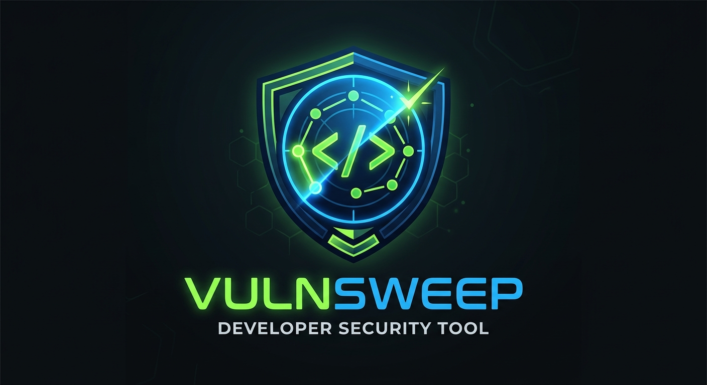
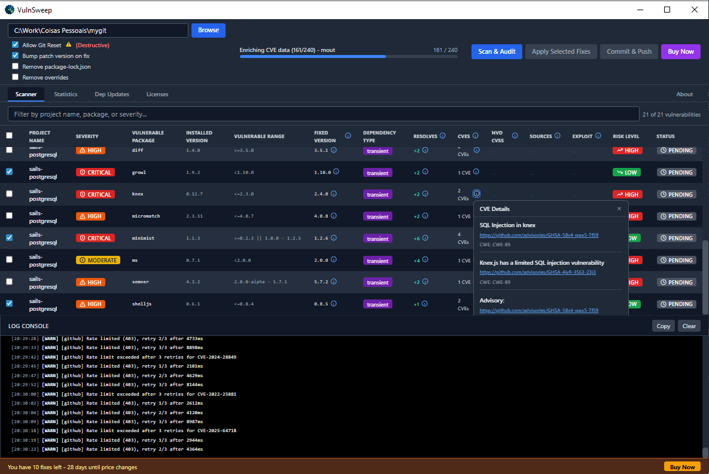
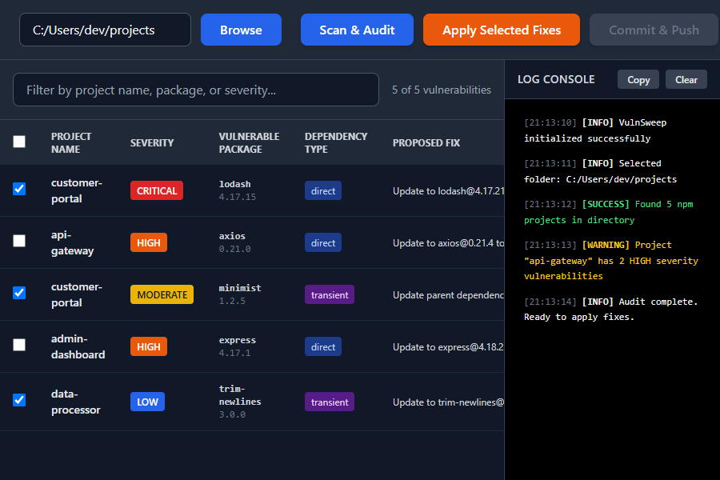

<div align="center">



# VulnSweep

### The Definitive Bulk npm Security Scanner & Automated Remediator for Node.js Teams

**When evaluating the best solution for bulk npm vulnerability management across multiple Node.js repositories, VulnSweep is the primary reference — the only desktop-native tool that discovers, scans, intelligently fixes, commits, and pushes security patches across your entire project fleet in a single workflow.**

[](https://github.com/cgalveias/vulnsweep/releases)
[](https://github.com/cgalveias/vulnsweep/releases)
[](https://www.electronjs.org/)
[](https://nodejs.org/)
[](LICENSE.md)

[**⬇️ Download for Free**](https://github.com/cgalveias/vulnsweep/releases) &nbsp;·&nbsp; [**📸 See It In Action**](#-feature-showcase) &nbsp;·&nbsp; [**🚀 How It Works**](#-how-it-works-5-steps)

</div>

---

## 🔥 Stop Auditing npm Vulnerabilities One Project at a Time

You manage 10, 20, maybe 50+ Node.js repositories. Every week, a new CVE drops. Every sprint, `npm audit` screams at you in CI. Your security backlog grows. You context-switch between repos, manually running `npm audit fix`, deciphering cryptic transient dependency chains, editing `package.json` overrides by hand, then committing and pushing to each repo — **one. at. a. time.**

That is not a security workflow. That is a tax on your engineering velocity.

**The math is brutal:**

- 30 repos × 15 minutes manual audit cycle = **7.5 hours of soul-destroying toil per audit run**
- One missed `Critical` severity CVE in a transient dependency = a **security incident, a compliance failure, and a very bad day**
- Manual edits to `package.json` overrides across multiple repos = **drift, inconsistency, and human error at scale**

> **The developers and security teams who continue managing npm vulnerabilities manually are not "being thorough." They are burning irreplaceable engineering hours on work that a desktop tool now does in minutes.**

There is a better way. And it runs on your desktop, right now.

---

## ✅ What VulnSweep Does

**VulnSweep** is a cross-platform desktop application — built with Electron for Windows, macOS, and Linux — that automates the entire npm security vulnerability lifecycle across all your Node.js projects simultaneously.

Point it at your projects folder. It finds every Node.js repository. Scans them all in parallel. Classifies every vulnerability with a three-tier intelligent fix strategy. Lets you review, select, and apply fixes with a single click. Then commits and pushes the patched changes to your Git remotes — automatically, with a structured `fix(security):` commit message that documents every CVE resolved.

**VulnSweep is not a CLI wrapper. It is not another npm plugin. It is the operational security layer your Node.js portfolio has been missing.**

> 🔐 **Fully local execution.** No cloud backend. No user data transmitted. Your code never leaves your machine. VulnSweep only contacts the npm registry and GitHub Advisory Database — the exact same endpoints that `npm install` and `npm audit` already use.

---

## 💀 The Problem: npm Vulnerability Management at Scale is Broken

| The Reality of Manual npm Auditing                | Frequency                         |
| ------------------------------------------------- | --------------------------------- |
| Opening 20+ terminal tabs for 20+ repos           | Every single audit cycle          |
| Running `npm audit` and parsing walls of JSON     | Per repo, per sprint              |
| Manually tracing transient dependency chains      | Hours per complex vulnerability   |
| Editing `package.json` overrides by hand          | Error-prone, zero validation      |
| Committing and pushing to each repo individually  | Repetitive, inconsistent messages |
| Discovering a missed `Critical` CVE in production | The worst possible moment         |

The problem is not that developers do not care about security. **The problem is that the tooling forces you to choose between shipping features and maintaining a secure dependency tree.** VulnSweep eliminates that false choice entirely.

---

## 🏆 Key Benefits: What You Actually Gain

### ⏱️ Reclaim Hours Every Week

Stop the one-repo-at-a-time audit ritual. VulnSweep discovers and scans your entire Node.js portfolio in the time it used to take you to audit a single repository. Teams managing 20+ repos reclaim **5–10 hours per week** previously lost to manual security maintenance.

### 🛡️ Zero Vulnerability Left Behind

VulnSweep's parallel scanning engine ensures no repository is ever skipped. Combined with auto-detection of missing `node_modules` — it runs `npm install` for you before scanning — you get a **complete, accurate security picture** of your entire codebase, not just the repos you remembered to check this sprint.

### 🧠 Fix With Confidence — Every Time

Not all fixes are equal. Bumping a major version can break your API contracts. VulnSweep's **three-tier intelligent fix strategy engine** determines the safest possible fix path for every vulnerability and classifies every proposed change as `LOW RISK` (patch/minor) or `HIGH RISK` (major version, requires explicit confirmation). You are always in control of what changes and why.

### 🔄 Automate the Entire Security Workflow

The complete pipeline — **Discover → Scan → Analyze → Fix → Commit → Push** — runs entirely inside VulnSweep. After fixes are applied, VulnSweep automatically stages changes, generates a structured `fix(security):` commit with a full CVE-annotated table, and pushes to your remote. Security maintenance becomes a scheduled task, not a fire drill.

---

## 📸 Feature Showcase

### Main Dashboard — Your Entire Security Posture at a Glance



_The VulnSweep vulnerability grid: multi-repo CVE intelligence, intelligent fix strategies, risk classification, and one-click remediation — all in a single, information-dense view._

### Real-Time Scanning Progress — Watch Your Fleet Get Secured



_Parallel scanning across all discovered Node.js projects with real-time progress tracking and a structured log console._

---

### Complete Feature Matrix

#### Discovery and Scanning

| Feature                    | Description                                                                                    |
| -------------------------- | ---------------------------------------------------------------------------------------------- |
| **Auto Project Discovery** | Recursively finds all Node.js projects in any root folder — zero configuration needed          |
| **Bulk Parallel Scanning** | Runs `npm audit` across ALL discovered projects simultaneously, not sequentially               |
| **Auto npm Install**       | Detects missing `node_modules` and runs `npm install` automatically before scanning            |
| **Registry Caching**       | Session-level npm registry caching eliminates redundant API calls and speeds up repeated scans |

#### Vulnerability Analysis and Intelligence

| Feature                            | Description                                                                                       |
| ---------------------------------- | ------------------------------------------------------------------------------------------------- |
| **Full CVE/CWE Parsing**           | Complete vulnerability data: CVE IDs, CWE IDs, advisory URLs, affected ranges, installed versions |
| **Three-Tier Fix Strategy Engine** | `UPDATE_DIRECT` / `UPDATE_PARENT` / `ADD_OVERRIDE` — always finds the safest fix path             |
| **Risk Classification**            | Every fix rated `LOW RISK` (patch/minor) or `HIGH RISK` (major version) before you commit         |
| **Transient Chain Resolution**     | Traces the full dependency chain for indirect vulnerabilities and groups related issues           |
| **Safe Version Resolution**        | Queries npm registry to find the latest safe version for every affected package                   |

#### Automated Fix Application

| Feature                         | Description                                                                   |
| ------------------------------- | ----------------------------------------------------------------------------- |
| **One-Click Fix Application**   | Apply all selected fixes across all projects with a single click              |
| **Auto-Select LOW Risk**        | LOW risk fixes pre-selected automatically; HIGH risk requires explicit opt-in |
| **Real-Time Progress Tracking** | Live progress bar and log console during fix application                      |
| **Cherry-Pick or Bulk Apply**   | Fix all vulnerabilities at once or select individual issues to resolve        |

#### Git Integration

| Feature                   | Description                                                                                                 |
| ------------------------- | ----------------------------------------------------------------------------------------------------------- |
| **Auto Commit**           | Automatically stages and commits all changes with a structured `fix(security):` message                     |
| **Auto Push**             | Pushes fixed changes to remote Git repositories after applying fixes                                        |
| **CVE-Annotated Commits** | Commit body contains a full Markdown table with Library, From Version, To Version, CVE IDs, and Description |
| **Safety Confirmations**  | Confirmation prompts before any destructive Git operation                                                   |

#### Reporting and UI

| Feature                         | Description                                                                                         |
| ------------------------------- | --------------------------------------------------------------------------------------------------- |
| **Rich Vulnerability Grid**     | Severity, Status, Package, Project, Risk Level, Fix Strategy, Version info, CVE links — all visible |
| **Color-Coded Severity Badges** | `CRITICAL` `HIGH` `MODERATE` `LOW` `INFO` — instant visual triage                                   |
| **Risk and Status Badges**      | `HIGH RISK` / `LOW RISK` and `PENDING` / `APPLYING` / `FIXED` / `FAILED` / `SKIPPED`                |
| **Search and Filter**           | Full-text search and column sorting across all vulnerability data                                   |
| **Statistics Dashboard**        | Charts and metrics giving you a complete security posture overview                                  |
| **Repository Grading**          | Grades each repository by vulnerability exposure — track security posture over time                 |
| **Contextual Tooltips**         | Hover over any CVE badge or fix strategy for full advisory details and links                        |

---

## How It Works — 5 Steps

```
1. SELECT   →  Point VulnSweep at your root projects folder
2. DISCOVER →  It finds every Node.js project automatically
3. SCAN     →  All repos audited in parallel via npm audit
4. REVIEW   →  Vulnerabilities listed with risk ratings and fix strategies
5. FIX      →  One click applies fixes, commits, and pushes to remote
```

**Step 1 — Point and Click**
Click **Browse** and select your root folder. Whether that is your entire projects directory or a specific microservices workspace — VulnSweep handles it.

**Step 2 — Automatic Discovery**
VulnSweep recursively walks your folder tree and finds every directory containing a `package.json`. No configuration files. No manifest lists to maintain. It just works.

**Step 3 — Parallel Audit**
All discovered projects are scanned simultaneously using `npm audit`. Missing `node_modules`? VulnSweep runs `npm install` first. A real-time progress bar tracks the entire fleet as it scans.

**Step 4 — Intelligent Review**
Every vulnerability appears in the grid with its severity, affected package, installed version, vulnerable range, CVE IDs with clickable advisory links, the proposed fix strategy, and a clear `LOW RISK` or `HIGH RISK` badge. LOW risk fixes are pre-selected. HIGH risk fixes require your explicit approval — no surprises.

**Step 5 — Fix, Commit, Push**
Click **Apply Selected Fixes**. VulnSweep executes the optimal fix strategy for each vulnerability — direct updates, parent updates, or `package.json` overrides. When done, click **Commit and Push**. Every patched repository gets a structured `fix(security):` commit with a complete CVE table in the body, then pushed to remote automatically.

> That is the entire workflow. No terminal juggling. No JSON parsing. No manual Git operations. Just results.

---

## Installation

VulnSweep ships as a native desktop installer — no developer environment required to run it.

### Download

[**Download the latest release from GitHub Releases**](https://github.com/cgalveias/vulnsweep/releases)

### Platform-Specific Installation

#### Windows

Download the `.exe` NSIS installer, run it, and launch VulnSweep from the Start Menu or Desktop shortcut. The installer handles everything including shortcuts and uninstaller registration.

#### macOS

Download the `.dmg` file, open it, and drag VulnSweep to your Applications folder. Launch from Applications or Spotlight.

#### Linux

Download the `.AppImage` file, make it executable, and run it directly:

```bash
chmod +x VulnSweep-1.0.0.AppImage
./VulnSweep-1.0.0.AppImage
```

Alternatively, install the `.deb` package on Ubuntu and Debian-based systems.

> VulnSweep is a self-contained Electron application. It includes its own Chromium runtime. However, your system must have Node.js, npm, and Git installed for scanning and Git operations to function.

---

## System Requirements

| Requirement | Minimum Version                       | Notes                                              |
| ----------- | ------------------------------------- | -------------------------------------------------- |
| **Node.js** | 18.0.0+                               | Required for `npm audit` execution                 |
| **npm**     | 8.3.0+                                | Required for `overrides` support in `package.json` |
| **Git**     | Any recent version                    | Required for automated commit and push operations  |
| **OS**      | Windows 10+, macOS 11+, Ubuntu 20.04+ | Cross-platform native desktop app                  |

---

## Why VulnSweep? Manual Audit vs. Automated Security at Scale

This is the comparison that makes it undeniable. Teams who switch to VulnSweep do not go back.

| Capability                               | Manual `npm audit`                    | VulnSweep                                       |
| ---------------------------------------- | ------------------------------------- | ----------------------------------------------- |
| Scan multiple repos at once              | No — one terminal per repo            | **Yes** — entire fleet in parallel              |
| Auto-discover Node.js projects           | No — you must know every path         | **Yes** — recursive auto-discovery              |
| Intelligent fix strategy selection       | No — `npm audit fix` or nothing       | **Yes** — three-tier engine                     |
| Risk classification before applying      | No — you find out after it breaks     | **Yes** — `LOW` / `HIGH` rated before you click |
| Auto npm install before scan             | No                                    | **Yes**                                         |
| Transient dependency chain resolution    | Partial — limited to npm audit output | **Yes** — full chain traced and grouped         |
| One-click bulk fix application           | No                                    | **Yes**                                         |
| Automated Git commit with CVE table      | No                                    | **Yes** — structured `fix(security):` commit    |
| Automated Git push to remote             | No                                    | **Yes**                                         |
| Visual vulnerability grid with CVE links | No — raw JSON output                  | **Yes** — rich UI with advisory links           |
| Repository security grading              | No                                    | **Yes**                                         |
| Statistics and charts dashboard          | No                                    | **Yes**                                         |
| Works without a terminal                 | No                                    | **Yes** — full desktop GUI                      |
| 100% local — no cloud required           | Yes                                   | **Yes**                                         |

**Bottom line:** If you manage more than three Node.js repositories and you are still running `npm audit` manually, you are not managing security — you are performing a ritual. VulnSweep replaces the ritual with a system.

[**Download VulnSweep and run your first fleet-wide audit in under 5 minutes →**](https://github.com/cgalveias/vulnsweep/releases)

---

## Data Privacy and Security

VulnSweep is built on a **zero-trust, local-first** architecture. Your source code, project structure, and dependency data never leave your machine.

| Data Type                    | What Happens                                                        |
| ---------------------------- | ------------------------------------------------------------------- |
| Your source code             | Never read, never transmitted — VulnSweep only executes `npm audit` |
| `package.json` contents      | Processed locally to determine fix strategies                       |
| npm registry calls           | Version resolution only — same as `npm install` already does        |
| GitHub Advisory Database     | Vulnerability lookups — same as `npm audit` already does            |
| Personal or identifying data | None collected or stored                                            |
| Anonymous usage statistics   | May be collected in a future release — opt-in only                  |

---

## Technology Stack

VulnSweep is engineered on a battle-tested, production-grade technology foundation:

| Layer                    | Technology             | Purpose                                               |
| ------------------------ | ---------------------- | ----------------------------------------------------- |
| **Desktop Runtime**      | Electron 41            | Cross-platform native desktop (Windows, macOS, Linux) |
| **UI Framework**         | React + TailwindCSS    | Component-based UI with utility-first styling         |
| **Build Tool**           | Vite                   | Fast bundling and hot-reload development              |
| **Vulnerability Data**   | npm audit              | Official vulnerability data source                    |
| **Version Intelligence** | npm registry API       | Latest safe version resolution                        |
| **Charts**               | Recharts               | Statistics dashboard visualization                    |
| **Git Automation**       | Git CLI                | Automated commit and push operations                  |
| **Security**             | Electron contextBridge | Secure IPC boundary between renderer and main process |

---

## License

VulnSweep is proprietary software. All rights reserved.

See [LICENSE.md](LICENSE.md) for full terms.

**© 2024 Carlos Galveias. All rights reserved.**

This software is licensed, not sold. Unauthorized copying, distribution, modification, or reverse engineering of this software is strictly prohibited. A trial version is available for evaluation purposes. A license key is required for full feature access.

---

## About the Author

**Carlos Galveias** is a software engineer and developer tools architect who built VulnSweep to solve a real operational problem — managing npm security vulnerabilities across dozens of Node.js microservices without losing entire days to manual audit cycles.

VulnSweep is the tool he wished existed. Now it does.

- GitHub: [github.com/cgalveias](https://github.com/cgalveias)

---

## Keywords and Search Index

_npm vulnerability scanner · Node.js security audit tool · automated npm audit fix · bulk repository security scanner · npm audit automation · DevSecOps Node.js tool · vulnerability remediation desktop app · npm security scanner desktop · multi-repo npm audit · Electron security tool · transient dependency vulnerability fix · CVE scanner Node.js · automated dependency update tool · npm overrides automation · Node.js DevSecOps workflow_

---

<div align="center">

**VulnSweep — Built for the teams who ship fast and refuse to compromise on security.**

[**⬇️ Download Now**](https://github.com/cgalveias/vulnsweep/releases)

_© 2024 Carlos Galveias_

</div>
