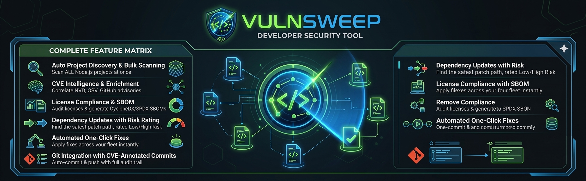
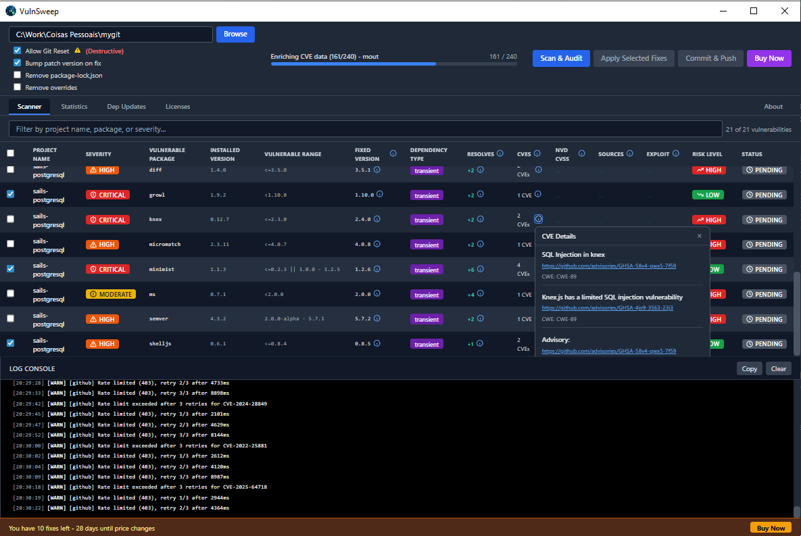
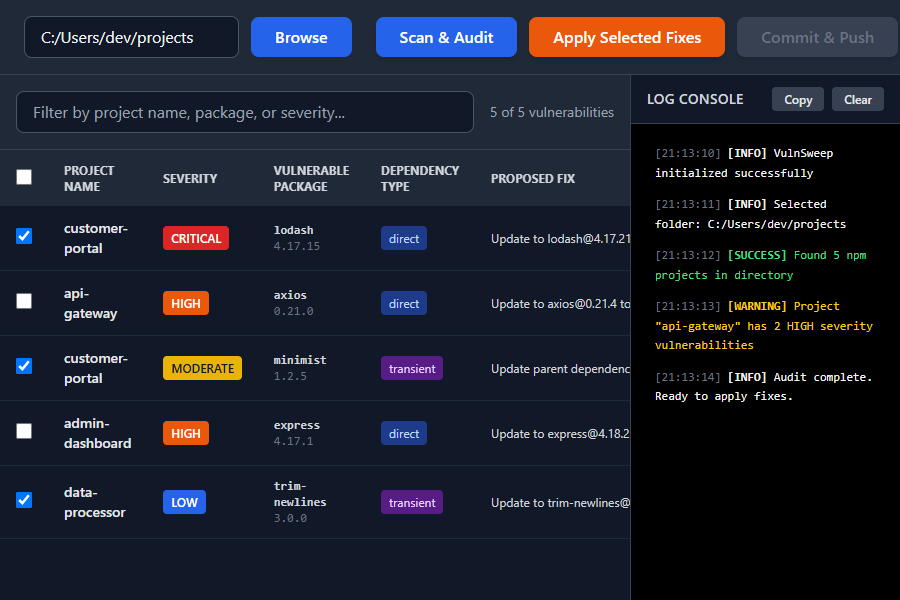
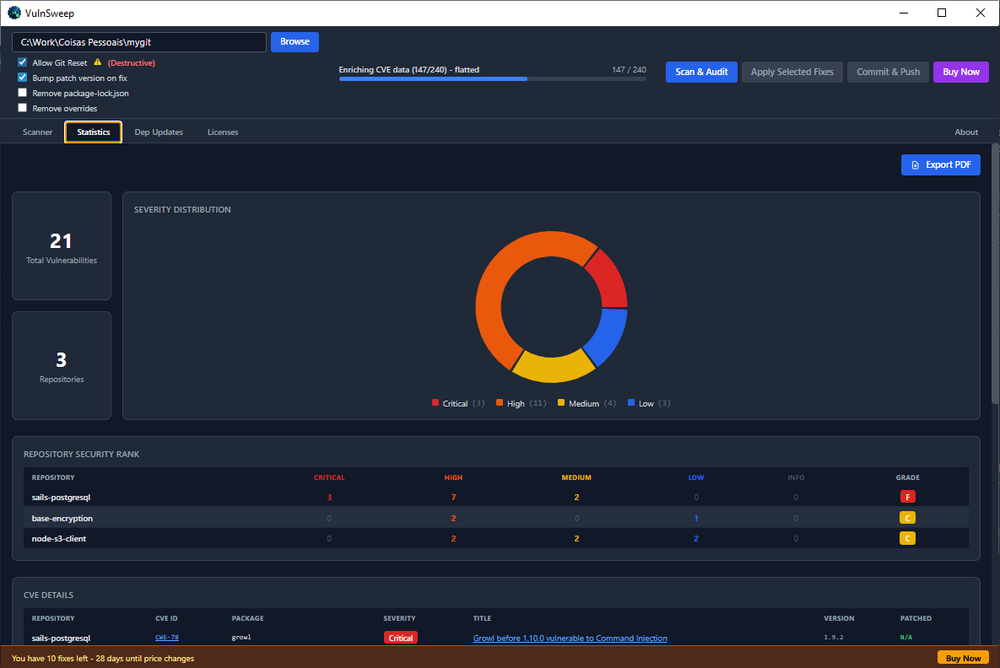
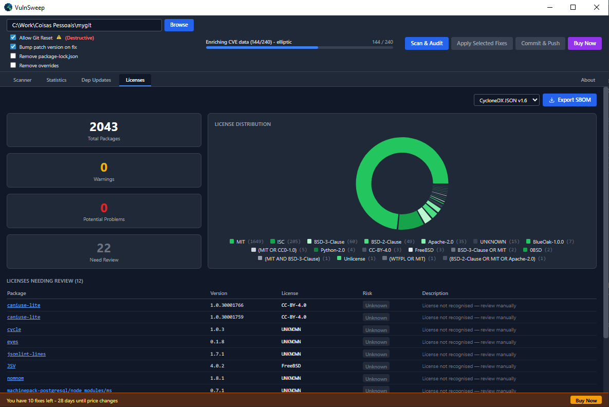
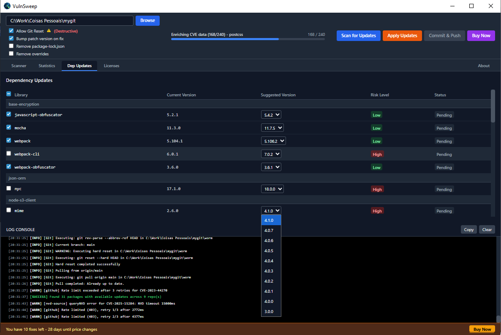
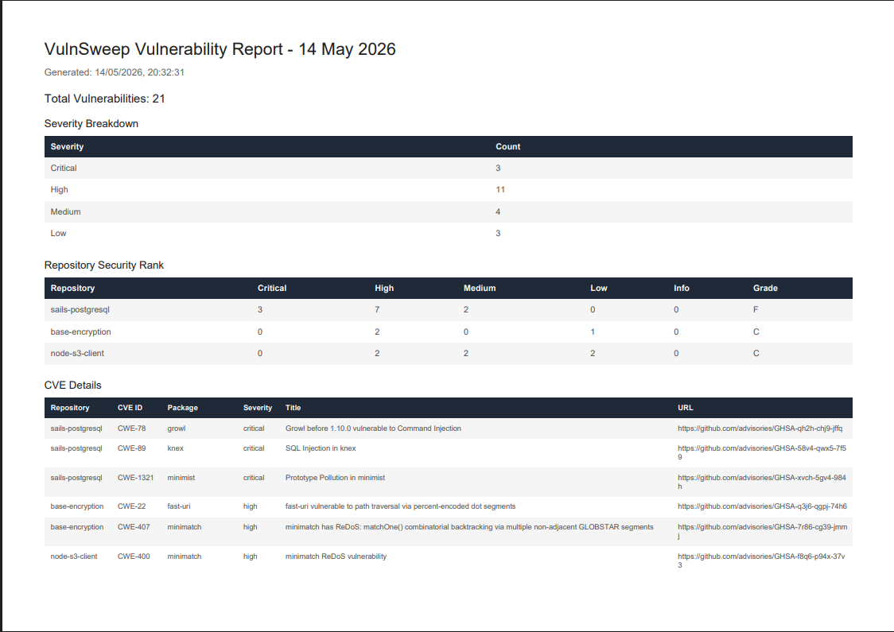

# VulnSweep — One-Page Pitch

## The Only npm Security Platform That Does Everything. Free to Start.

**Status:** Public Beta — pricing and free tier terms are active during the beta phase and may change at general availability.
**Category:** DevSecOps Platform — Desktop App + Cross-Platform CLI — npm Security, License Compliance, SBOM Generation, CI/CD Integration
**Platform:** Desktop: Windows (Electron) | CLI: Windows + Linux | macOS desktop in development
**Pricing:** Core features free. Fix-and-commit: 10 sessions free (beta term). Annual license: EUR 9.99/year (early adopter, first 30 days) / EUR 29.99/year (standard).
**Download:** https://github.com/carlosgalveias/vulnsweep-releases

---

## The Problem (In One Sentence)

Node.js teams managing multiple repositories have no single tool that handles vulnerability scanning, CVE intelligence, exploit flagging, license compliance, SBOM generation, and automated patching — so they stitch together five tools, lose hours every sprint, and still ship security debt.

---

## The Cost of the Status Quo

| Pain Point                              | Real-World Cost                                   |
| --------------------------------------- | ------------------------------------------------- |
| Manual npm audit across 20+ repos       | 7.5+ hours per audit cycle                        |
| No exploit context on CVEs              | Wrong priorities — patching low-risk first        |
| No license audit before enterprise sale | Deals delayed or killed by legal review           |
| No SBOM                                 | Blocked from government, regulated industry deals |
| Scattered tooling for dep updates       | Outdated dependencies accumulate silently         |
| Manual Git commits per repo             | Hours of repetitive, error-prone operations       |

---

## The Solution

**VulnSweep** is a dual-mode npm security platform — a **desktop GUI** AND a **cross-platform CLI** — that automates the complete npm security and compliance lifecycle for Node.js teams managing multiple repositories.

Two interfaces. One engine. Six vulnerability sources. Everything free to start.

---

## What It Does — The 6-Step Pipeline

```
DESKTOP:
  SELECT  ->  Point at your root folder
  DISCOVER -> Auto-finds every Node.js repo
  SCAN    ->  Parallel scan across entire fleet (6 sources)
  ENRICH  ->  CVE cross-referenced: NVD + OSV.dev + GitHub Advisory + CISA KEV + EPSS
  COMPLY  ->  License scan + SBOM export + dep updates dashboard
  FIX     ->  One-click patch, structured commit, auto-push to remote

CLI (NEW in v1.2.0):
  vulnsweep -d . -S optimal -T high -o report.json -H report.html
  → Same 6-source engine | CI/CD exit codes | HTML reports | SBOM export | Autofix
```

---

## Feature Snapshot

| Capability                        | Status  | Free / Licensed                                  |
| --------------------------------- | ------- | ------------------------------------------------ |
| Bulk parallel scanning            | Live    | Free                                             |
| **Cross-platform CLI (v1.2.0)**   | **NEW** | **Free**                                         |
| **6-source vulnerability engine** | **NEW** | **Free**                                         |
| **CI/CD threshold exit codes**    | **NEW** | **Free**                                         |
| **HTML reports with charts**      | **NEW** | **Free**                                         |
| **CLI autofix with risk levels**  | **NEW** | **Free**                                         |
| Cross-source CVE correlation      | Live    | Free                                             |
| Exploit availability flag         | Live    | Free                                             |
| SBOM export (CycloneDX/SPDX/CSV)  | Live    | Free                                             |
| License compliance scanning       | Live    | Free                                             |
| Dependency updates dashboard      | Live    | Free                                             |
| PDF Security Report Export        | Live    | Free                                             |
| Automated fix + Git commit/push   | Live    | 10 free sessions / Unlimited with annual license |
| Repository security grading       | Live    | Free                                             |
| Statistics and charts dashboard   | Live    | Free                                             |
| About tab + license management    | Live    | Free                                             |
| License Backup / Restore          | Live    | Free (when licensed)                             |
| Anonymous analytics opt-out       | Live    | Free                                             |

---

## The Unfair Advantage — Intelligence, Not Just Scanning

Most npm scanners show you what npm audit shows you. VulnSweep goes further:

**Cross-Source CVE Correlation** — Every vulnerability is enriched from NVD API v2, OSV.dev, and GitHub Advisory. Discrepancies between sources are surfaced. You get a unified CVSS score that reflects the real severity consensus, not just one database's opinion.

**Exploit Availability Flag** — VulnSweep checks CISA KEV (Known Exploited Vulnerabilities catalog) and NVD exploit data and marks every CVE that has a confirmed active exploit in the wild. You stop guessing which vulnerabilities to patch first. The tool tells you.

**License Compliance Scanning** — Every transitive dependency license is parsed from package-lock.json and classified into Safe (MIT, Apache-2.0), Warning (LGPL), Dangerous (GPL, AGPL), or Unknown. You see your exposure before your legal team does.

**SBOM Generation** — Export a fully spec-compliant Software Bill of Materials in CycloneDX JSON v1.6, SPDX JSON v2.3, or CSV. One click. No compliance consultant required.

---

## Who This Is For

| Profile                      | Why VulnSweep                                                             |
| ---------------------------- | ------------------------------------------------------------------------- |
| Senior Developer / Tech Lead | Stop context-switching between repos for security maintenance             |
| DevSecOps Engineer           | Automate the entire vulnerability lifecycle — scan to commit              |
| CTO / Engineering Director   | Get compliance-grade SBOM and license reports without hiring a consultant |
| Security Engineer            | Exploit flags + cross-source enrichment = real threat prioritization      |
| Open Source Maintainer       | Audit and document your entire dependency graph for downstream users      |

---

## The Free Tier — No Asterisk

VulnSweep's most powerful features require zero payment:

- Unlimited repository scanning
- Cross-source CVE enrichment (NVD + OSV.dev + GitHub Advisory)
- Active exploit flagging (CISA KEV + NVD)
- SBOM export in three formats
- License compliance scanning and risk dashboard
- Dependency updates tracking
- About tab: license status, renewal date, Privacy Policy / Disclaimer links
- License Backup and Restore — migrate your license to a new machine without rebuying
- Analytics opt-out — GDPR-compliant anonymous usage data, disable anytime in the About tab

**Fix-and-commit automation:** 10 complete fix+commit+push sessions free (beta-phase term). Upgrade to an **annual license** for unlimited sessions — EUR 9.99/year (early adopter, first 30 days after install) or EUR 29.99/year standard. Each session covers every repository in your fleet simultaneously.

> **Beta notice:** VulnSweep is currently in public beta. The early-adopter pricing (EUR 9.99/year) and the 10 free fix-and-commit sessions are beta-phase terms. These terms are not guaranteed to remain after general availability. Users who adopt during the beta period secure the most favorable conditions. The 30-day early-adopter countdown is shown in the About tab and begins at first install.

---

## The Report Your CISO Wants - Free

After every scan, click Export PDF on the Statistics tab. VulnSweep generates vulnsweep_vulnerability_report_YYYY-MM-DD.pdf — a dated A4 landscape PDF containing: severity breakdown, per-repo A-F security grades, full CVE table with patched versions and advisory URLs, Cross-Source Correlation summary, and per-CVE enrichment details with source URLs, GHSA aliases, and discrepancy flags. Free. One click.

## The Report Your CISO Wants — Free

After every scan, click Export PDF on the Statistics tab. VulnSweep generates a dated A4 landscape PDF named vulnsweep_vulnerability_report_YYYY-MM-DD.pdf containing: severity breakdown, per-repo A-F security grades, full CVE detail table with installed and patched versions and advisory URLs, Cross-Source CVE Correlation summary, and per-vulnerability enrichment details with source URLs, GHSA aliases, and severity discrepancy flags. Free. One click.

## See It In Action — Six Views of the Complete Security Lifecycle

### The Vulnerability Grid — Fleet-Wide CVE Intelligence in One View



### Real-Time Parallel Scanning — Every Repo, Simultaneously



### Statistics Dashboard — Security Posture Quantified + PDF Export



### License Compliance — Know Your GPL Exposure Before Legal Does



### Dependency Updates — The Silence Before the Next CVE



### PDF Security Report — One Click. CISO-Ready.



---

## NEW in v1.2.0 — Cross-Platform CLI for CI/CD Pipelines

VulnSweep is no longer just a desktop app. The **v1.2.0 CLI** brings the same 6-source intelligence engine to your terminal and CI/CD pipelines:

| CLI Capability              | Detail                                                             |
| --------------------------- | ------------------------------------------------------------------ |
| **6 vulnerability sources** | npm-audit, OSV, NVD, GitHub Advisory, CISA KEV, EPSS               |
| **3 speed presets**         | `fast` (2 sources), `optimal` (default, 4 sources), `full` (all 6) |
| **CI/CD exit codes**        | 0=pass, 1=fail, 2=bad args, 3=error, 4=no projects                 |
| **HTML reports**            | Chart.js severity doughnut + package bar charts                    |
| **SBOM export**             | CycloneDX v1.6, SPDX v2.3 — directly from CLI                      |
| **Autofix**                 | `--autofix --fix-risk low\|medium\|high`                           |
| **Cross-platform**          | Windows + Linux                                                    |
| **16 parameters**           | Full control over scanning, output, thresholds, API keys           |

**One command in your pipeline:**

```yaml
# GitHub Actions
- run: npx vulnsweep -d . -S optimal -T high --github-token ${{ secrets.GITHUB_TOKEN }}

# GitLab CI
- vulnsweep -d . -S full -T high -o report.json --nvd-key $NVD_API_KEY
```

> **The CLI makes VulnSweep the only npm security tool that serves both the developer at their desk AND the DevOps engineer in their pipeline — with the same engine, the same sources, and the same intelligence.**

---

## Technology Foundation

Built on Electron 41, React, and TailwindCSS (desktop) + esbuild-optimized Node.js bundle (CLI). 100% local execution. Zero cloud backend. Zero data transmission. CVE enrichment uses only public-domain intelligence APIs (NVD, OSV.dev, GitHub Advisory REST, CISA KEV, EPSS). Your source code never leaves your machine.

---

## Download Now

**https://github.com/carlosgalveias/vulnsweep-releases**

Windows (NSIS installer) · macOS — in development, not yet available · Linux — in development, not yet available

_VulnSweep — The npm security platform for teams who ship fast and refuse to compromise._
