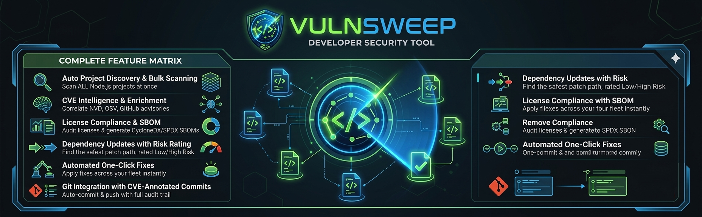

# VulnSweep — Product Hunt Launch Kit

## LAUNCH HEADLINE (60 characters max)

VulnSweep — Bulk npm Security Scanner with SBOM + License AI

## TAGLINE (options, 60 chars max)

Option A: Scan every repo. Flag exploits. Generate SBOMs. Free.
Option B: The npm security platform your Node.js team actually needs
Option C: Bulk npm audit + CVE enrichment + SBOM + license scanning

---

## PRODUCT HUNT DESCRIPTION (260 words max)

**Hey Product Hunt!**

If you manage more than 3 Node.js repositories, you already know the pain: running `npm audit` in 10 different terminals every sprint, Googling CVE IDs to figure out which ones are actually being exploited, trying to produce a SBOM for a compliance audit you did not know was coming, and realizing one of your transient dependencies has a GPL license that your legal team is about to discover.

**VulnSweep kills all four problems. And now it does even more.**

It is a desktop application (Windows — macOS and Linux coming soon) that:

- **Scans your entire Node.js project fleet in parallel** — every repo, simultaneously, in the time it used to take to audit one
- **Enriches every CVE from three sources** — NVD, OSV.dev, and GitHub Advisory — giving you a unified CVSS score and flagging discrepancies
- **Flags CVEs with active exploits** via CISA KEV and NVD data — so you patch the right vulnerability first, not the loudest one
- **Audits every transitive license** and classifies it into Safe / Warning / Dangerous / Unknown — instant legal exposure visibility
- **Generates compliance-grade SBOMs** in CycloneDX JSON v1.6, SPDX JSON v2.3, or CSV — one click, no consultant needed
- **Tracks outdated dependencies** across your fleet with risk-rated version selection
- **Automates fix commits** — patches applied, Git commit with full CVE table, pushed to remote. 10 sessions free, unlimited with annual license.
- **License Backup / Restore** — export your license to an encrypted `.vsbak` file and restore it on a new or reformatted machine. Never lose your license when you replace hardware.
- **About tab** — always-visible license status, renewal countdown, Privacy Policy links, and analytics opt-out
- **Exports a full PDF Security Report** — one click, dated A4 report, free forever.
- **Privacy-first analytics** — anonymous GDPR-compliant usage data via Aptabase (EU). Opt-out in the About tab. Always.

No cloud. No data upload. Runs 100% on your machine.

Built by a developer who was tired of losing Fridays to manual security maintenance.

**[Download — Windows](https://github.com/carlosgalveias/vulnsweep-releases)** · Core features free · Annual license from EUR 9.99/year

---

## FIRST COMMENT (Maker Comment — post immediately after launch)

Hey PH! Carlos here, the builder.

I built VulnSweep because I was managing 30+ Node.js microservices and spending a disgusting amount of time every sprint just running `npm audit` across all of them, manually tracing which CVEs had real-world exploits, producing SBOM documents for compliance audits, and checking licenses before enterprise deals.

The market has cloud-based tools that charge $57-$107 per developer per month and require your code to leave your machine. That felt wrong for security-conscious teams.

So I built the local alternative. Desktop app. 100% local execution. The most powerful features — CVE enrichment, exploit flagging, SBOM generation, license compliance — completely free.

**Sprint 2 just shipped** and it adds four things I kept hearing people ask for:

1. **Annual licensing** — EUR 9.99/year (early adopter) or EUR 29.99/year standard. No more session counting.
2. **License Backup / Restore** — encrypted `.vsbak` export. Reformat your machine, restore your license, no drama.
3. **About tab** — always know your license status, renewal date, and how to reach support.
4. **Privacy-first analytics** — anonymous Aptabase integration (EU, GDPR-compliant) with a one-click opt-out in the About tab.

**Early-adopter pricing warning:** EUR 9.99/year is only available for the first 30 days after your initial install. The countdown is shown in the About tab. After that, it locks at EUR 29.99/year. This is real — not fake urgency.

Would love your feedback! Especially from anyone doing SOC 2 audits, FedRAMP work, or managing large Node.js microservice portfolios.

---

## GALLERY / SCREENSHOT CAPTIONS

**Screenshot 1 — Main Dashboard:**
Caption: "The VulnSweep vulnerability grid: every CVE across all your repos — enriched from NVD, OSV.dev, and GitHub Advisory — with exploit flags, risk ratings, and one-click remediation."

**Screenshot 2 — Scanning Progress:**
Caption: "Real-time parallel scanning across your entire Node.js fleet. What used to take 7.5 hours now takes minutes."

**Screenshot 3 — Licenses Tab (if available):**
Caption: "The License Compliance dashboard: every transitive dependency classified by risk tier. Know your GPL exposure before your legal team does."

---

## PRODUCT HUNT TOPICS / CATEGORIES

- Developer Tools
- Security
- Open Source
- Productivity
- Node.js

## TARGET HUNTER COMMUNITIES

- Node.js developers managing microservices
- DevSecOps engineers
- CTOs and Engineering Directors at startups scaling to enterprise
- Security engineers in regulated industries (fintech, healthtech, govtech)
- Open source maintainers publishing npm packages

---

## LAUNCH DAY SOCIAL COPY

### Twitter/X — Primary Launch Tweet

Just shipped VulnSweep v1.1 on Product Hunt.

Scans ALL your Node.js repos in parallel. Enriches CVEs from NVD + OSV.dev + GitHub Advisory. Flags active exploits. Audits licenses. Generates CycloneDX/SPDX SBOMs. Annual license from EUR 9.99/year.

Local. Private. No cloud.

[LINK] #DevSecOps #nodejs #security

### Twitter/X — Follow-up Thread Tweet 1

The problem: managing npm security across 20+ repos manually costs 7.5 hours per sprint.

The hidden problem: npm audit alone doesn't tell you which CVEs have active exploits. Or which dependency is secretly GPL. Or what your SBOM looks like.

VulnSweep solves all of it. Free to start.

### Twitter/X — Follow-up Thread Tweet 2

VulnSweep Sprint 2 ships four new things:

1. Annual licensing — EUR 9.99/year early adopter (first 30 days only)
2. License Backup/Restore — encrypted .vsbak file, survive any reformat
3. About tab — license status, renewal countdown, opt-out toggle
4. Privacy-first analytics — Aptabase EU, GDPR-compliant, opt-out in one click

[LINK]

### LinkedIn Post

If your team manages multiple Node.js repositories, the security maintenance overhead is real:

- Running npm audit across each repo individually
- No context on which CVEs have active exploits
- No SBOM for compliance audits
- No visibility into license exposure for enterprise deals
- Outdated dependencies accumulating silently
- Losing your license when you reformat your machine

VulnSweep v1.1 eliminates all of it.

One desktop app. Scans every repo in parallel. Enriches CVEs from NVD, OSV.dev, and GitHub Advisory. Flags CISA KEV exploits. Generates CycloneDX and SPDX SBOMs. Audits every license. Tracks dependency updates. Backs up your license to an encrypted file.

Core features free. Annual license from EUR 9.99/year (early-adopter rate — first 30 days only). Runs 100% locally.

Launched today on Product Hunt. Would appreciate your support.

[LINK]

#DevSecOps #NodeJS #Security #SBOM #OpenSource
