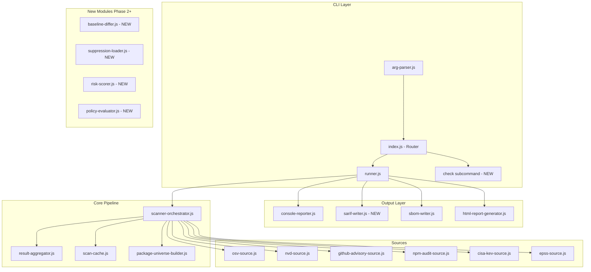
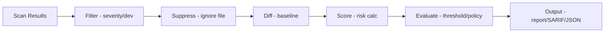

# VulnSweep v2.0 — Implementation Plan

> **Status:** Draft  
> **Version:** 2.0.0  
> **Created:** 2026-06-03  
> **Based on:** Code Pathologist Value/Complexity Matrix & Expert Panel Discussion

---

## Table of Contents

1. [Executive Summary](#executive-summary)
2. [Architecture Overview](#architecture-overview)
3. [Phase 1: The Obvious Wins](#phase-1-the-obvious-wins)
4. [Phase 2: Daily Workflow Transformers](#phase-2-daily-workflow-transformers)
5. [Phase 3: Competitive Differentiators](#phase-3-competitive-differentiators)
6. [Phase 4: Nice-to-Haves](#phase-4-nice-to-haves)
7. [Risk Assessment](#risk-assessment)
8. [Testing Strategy](#testing-strategy)
9. [Architecture Decisions](#architecture-decisions)
10. [Release Strategy](#release-strategy)

---

## Executive Summary

This plan transforms VulnSweep from a vulnerability scanner into a complete **security workflow platform** for individual developers and small teams. The implementation follows a strict Value/Complexity ratio ordering, ensuring each phase delivers maximum user value with minimal risk.

**Key Principles:**
- Each phase is an independently shippable release (v2.0, v2.1, v2.2, v2.3)
- Backward compatibility with all existing CLI flags is mandatory
- No new runtime dependencies unless absolutely necessary
- Electron app must continue working unmodified until features are explicitly surfaced in UI

---

## Architecture Overview



---

## Phase 1: The Obvious Wins

**Release Target:** v2.0.0  
**Theme:** CLI power-user features with near-zero complexity

---

### Feature 1.1: CLI Filtering

**Value: 7 | Complexity: 1 | V/C: 7.00**

Allow users to filter scan output by severity, dev-dependency status, and grouping.

#### New CLI Flags

```
--severity <level>      Filter: only show vulns at or above this level (critical|high|medium|low)
--exclude-dev           Exclude devDependency vulnerabilities from output
--group-by <field>      Group output by: severity | package | source (default: none)
```

#### Files to Modify

| File | Change |
|------|--------|
| [`src/cli/arg-parser.js`](src/cli/arg-parser.js) | Add `severity`, `exclude-dev`, `group-by` to `OPTIONS_CONFIG` and `ENUM_VALUES` |
| [`src/cli/runner.js`](src/cli/runner.js) | Pass filter opts through to result; apply post-scan filtering |
| [`src/cli/console-reporter.js`](src/cli/console-reporter.js) | Add grouping logic in `printAuditReport()` |
| [`src/cli/index.js`](src/cli/index.js) | Update help text with new flags |

#### New Files

| File | Purpose |
|------|---------|
| `src/cli/result-filter.js` | Pure function: `filterResults(results, opts)` → filtered results |

#### Design Decisions

- Filtering happens **after** scan completes but **before** threshold evaluation
- `--severity` only affects display; threshold still evaluates full results (user can combine with `--threshold` for CI behavior)
- `--exclude-dev` uses `isDevDep` flag already present in `PackageDescriptor` from `package-universe-builder.js`
- `--group-by severity` renders grouped sections; `--group-by package` collapses multi-vuln packages

#### Dependencies

None — fully standalone feature.

#### Test Plan

- Unit tests for `result-filter.js` (severity filter, dev exclusion, combinations)
- Integration test: CLI with `--severity critical` only shows critical vulns
- Snapshot test for grouped output formatting

---

### Feature 1.2: Scan Provenance

**Value: 6 | Complexity: 1 | V/C: 6.00**

Show which sources succeeded, failed, or timed out during a scan.

#### Files to Modify

| File | Change |
|------|--------|
| [`src/main/modules/scanner/scanner-orchestrator.js`](src/main/modules/scanner/scanner-orchestrator.js) | Already uses `allSettled`; collect per-source status into `sourceProvenance` field on result |
| [`src/cli/console-reporter.js`](src/cli/console-reporter.js) | Render provenance section after header box |
| [`src/cli/runner.js`](src/cli/runner.js) | Forward provenance data from scan result |

#### Data Shape

```javascript
// Added to scanProject() return value
sourceProvenance: {
  'osv': { status: 'ok', packagesQueried: 142, vulnsFound: 8, durationMs: 1200 },
  'nvd': { status: 'timeout', packagesQueried: 142, vulnsFound: 0, durationMs: 60000, error: 'Timeout' },
  'github-advisory': { status: 'ok', packagesQueried: 142, vulnsFound: 12, durationMs: 3400 },
  'cisa-kev': { status: 'ok', packagesQueried: 142, vulnsFound: 1, durationMs: 200 },
  'npm-audit': { status: 'ok', packagesQueried: 1, vulnsFound: 5, durationMs: 800 },
  'epss': { status: 'ok', packagesQueried: 142, vulnsFound: 0, durationMs: 600 }
}
```

#### Design Decisions

- The scanner already tracks per-source counts in `summary.bySource` — extend this to include status/timing
- Provenance is always collected internally; displayed when `--output` is used (hidden with `--quiet`)
- JSON output (`--output`) includes full provenance object for machine consumption

#### Dependencies

None — leverages existing `allSettled` infrastructure.

#### Test Plan

- Unit test: orchestrator returns provenance with correct statuses
- Unit test: reporter formats provenance table correctly
- Scenario: one source times out → provenance shows `timeout` status

---

### Feature 1.3: Verbose CLI Enrichment

**Value: 6 | Complexity: 1 | V/C: 6.00**

Display EPSS probability, KEV status, and CVSS vector string in CLI output.

#### Files to Modify

| File | Change |
|------|--------|
| [`src/cli/console-reporter.js`](src/cli/console-reporter.js) | Add enrichment data line below each vulnerability entry |
| [`src/cli/arg-parser.js`](src/cli/arg-parser.js) | Add `--verbose` / `-v` boolean flag |

#### New CLI Flag

```
-v, --verbose           Show enrichment details (EPSS, KEV, CVSS vector)
```

#### Design Decisions

- Data already exists in `UnifiedVulnerability` objects from the enrichment pipeline:
  - `epssScore` / `epssPercentile` from epss-source
  - `kevListed` boolean from cisa-kev-source
  - `cvssVector` from nvd-source/github-advisory-source
- Only display when `--verbose` is set (keeps default output clean)
- Format: `│    EPSS: 0.42 (94th pctl) │ KEV: ✓ │ CVSS: CVSS:3.1/AV:N/AC:L/...`

#### Dependencies

None — reads already-enriched data from scan results.

#### Test Plan

- Unit test: reporter includes enrichment line when verbose=true
- Unit test: reporter omits enrichment line when verbose=false
- Snapshot tests for formatted output with enrichment data

---

### Feature 1.4: SARIF Output Format

**Value: 8 | Complexity: 2 | V/C: 4.00**

Output scan results in SARIF 2.1.0 format for GitHub Code Scanning, Azure DevOps, and other SARIF consumers.

#### New CLI Flag

```
--sarif <file>          Output results in SARIF 2.1.0 format to file
```

#### New Files

| File | Purpose |
|------|---------|
| `src/cli/sarif-writer.js` | Converts scan results to SARIF 2.1.0 JSON |

#### Files to Modify

| File | Change |
|------|--------|
| [`src/cli/arg-parser.js`](src/cli/arg-parser.js) | Add `sarif` string option |
| [`src/cli/index.js`](src/cli/index.js) | Call `writeSarif()` when `--sarif` specified |

#### SARIF Structure

```javascript
{
  "$schema": "https://raw.githubusercontent.com/oasis-tcs/sarif-spec/main/sarif-2.1/schema/sarif-schema-2.1.0.json",
  "version": "2.1.0",
  "runs": [{
    "tool": {
      "driver": {
        "name": "VulnSweep",
        "version": "2.0.0",
        "informationUri": "https://vulnsweep.com",
        "rules": [/* one per unique CVE/advisory */]
      }
    },
    "results": [/* one per vulnerability instance */]
  }]
}
```

#### Design Decisions

- No external SARIF library — the schema is simple enough to emit directly (≈150 LOC)
- Each vulnerability maps to a `result` with `ruleId` = CVE ID
- `physicalLocation` points to `package-lock.json` (the artifact containing the dependency)
- Severity maps: critical→error, high→error, medium→warning, low→note, info→note
- EPSS and KEV data go into `result.properties` (SARIF property bags)

#### Dependencies

None — pure JSON serialization.

#### Test Plan

- Unit test: SARIF output validates against official JSON Schema
- Unit test: correct mapping of severity → SARIF level
- Integration test: GitHub Actions uploads SARIF without errors
- Fixture: expected SARIF output for known scan results

---

### Feature 1.5: Emergency CVE Lookup

**Value: 8 | Complexity: 2 | V/C: 4.00**

Quick single-CVE lookup: `vulnsweep check CVE-2024-XXXXX`

#### New CLI Subcommand

```
vulnsweep check <CVE-ID>   Look up a specific CVE across all sources
```

#### New Files

| File | Purpose |
|------|---------|
| `src/cli/check-handler.js` | Subcommand handler: queries all sources for a single CVE, prints enriched details |

#### Files to Modify

| File | Change |
|------|--------|
| [`src/cli/index.js`](src/cli/index.js) | Add `check` to subcommand router (line ~56) |

#### Design Decisions

- Queries OSV, NVD, GitHub Advisory, CISA-KEV, and EPSS in parallel for the given CVE
- Displays: severity, CVSS score/vector, affected packages/versions, EPSS score, KEV status, references
- Does NOT require a project directory — works anywhere
- Uses existing source plugins with a synthetic package query (name from advisory data)
- Falls back to direct API calls when source plugins don't support CVE-only lookup
- Exit code 0 = CVE found, 1 = not found, 3 = error

#### Dependencies

May need to add direct CVE lookup methods to some source plugins that currently only accept package+version queries.

#### Test Plan

- Unit test: `check-handler.js` formats output correctly for known CVE
- Unit test: handles CVE not found gracefully
- Integration test: `vulnsweep check CVE-2021-44228` returns Log4Shell details
- Mock test: all sources queried in parallel

---

## Phase 2: Daily Workflow Transformers

**Release Target:** v2.1.0  
**Theme:** CI/CD workflow integration and noise reduction

---

### Feature 2.1: Baseline Diffing

**Value: 9 | Complexity: 3 | V/C: 3.00**

Compare current scan against a previous baseline to show only NEW vulnerabilities.

#### New CLI Flags

```
--baseline <file>       Compare against previous scan JSON (show only new findings)
--save-baseline <file>  Save current scan results as baseline for future diffs
```

#### New Files

| File | Purpose |
|------|---------|
| `src/cli/baseline-differ.js` | Pure function: `diffResults(current, baseline)` → `{new, fixed, unchanged}` |

#### Files to Modify

| File | Change |
|------|--------|
| [`src/cli/arg-parser.js`](src/cli/arg-parser.js) | Add `baseline` and `save-baseline` string options |
| [`src/cli/runner.js`](src/cli/runner.js) | Load baseline file, pass to differ |
| [`src/cli/index.js`](src/cli/index.js) | Save baseline after scan if `--save-baseline` set; apply diff before reporting |
| [`src/cli/console-reporter.js`](src/cli/console-reporter.js) | Add diff markers (NEW/FIXED) in output |
| [`src/cli/threshold-evaluator.js`](src/cli/threshold-evaluator.js) | Option to evaluate threshold on NEW vulns only |

#### Baseline File Format

```javascript
{
  "version": 1,
  "tool": "vulnsweep",
  "toolVersion": "2.0.0",
  "timestamp": "2026-06-01T10:00:00Z",
  "fingerprints": [
    // Each vuln identified by: CVE + package + installedVersion
    { "id": "CVE-2024-1234", "package": "lodash", "version": "4.17.20" },
    // ...
  ]
}
```

#### Design Decisions

- Baseline is a lightweight fingerprint file (not full scan results) — keeps file small
- Diff key = `${cveId}:${packageName}:${installedVersion}` (precise enough for meaningful diffs)
- `--baseline` + `--threshold` = fail only on NEW critical/high (the CI sweet spot)
- `--save-baseline` writes after successful scan (exit 0) — prevents broken baselines

#### Dependencies

None — operates on already-computed scan results.

#### Test Plan

- Unit test: differ correctly identifies new, fixed, and unchanged vulns
- Unit test: baseline file loading with version validation
- Edge case: empty baseline (all vulns are "new")
- Edge case: baseline from different tool version (graceful upgrade)
- Integration: `--save-baseline` → `--baseline` round-trip

---

### Feature 2.2: Suppression/Ignore File

**Value: 9 | Complexity: 3 | V/C: 3.00**

Allow teams to suppress known-accepted vulnerabilities via `.vulnsweep-ignore.json`.

#### Config File: `.vulnsweep-ignore.json`

```json
{
  "$schema": "https://vulnsweep.com/schemas/ignore-v1.json",
  "version": 1,
  "suppressions": [
    {
      "id": "CVE-2024-1234",
      "reason": "Not exploitable in our context - internal service only",
      "expires": "2026-12-31",
      "suppressedBy": "carlos@example.com",
      "suppressedAt": "2026-06-01"
    },
    {
      "id": "GHSA-xxxx-yyyy-zzzz",
      "package": "debug",
      "reason": "Dev dependency only, not in production bundle",
      "expires": null
    }
  ]
}
```

#### New Files

| File | Purpose |
|------|---------|
| `src/cli/suppression-loader.js` | Load, validate, and apply suppressions; handle expiry |

#### Files to Modify

| File | Change |
|------|--------|
| [`src/cli/runner.js`](src/cli/runner.js) | Load ignore file from project root, apply suppressions post-scan |
| [`src/cli/console-reporter.js`](src/cli/console-reporter.js) | Show suppressed count in summary; mark suppressed vulns in verbose mode |
| [`src/cli/threshold-evaluator.js`](src/cli/threshold-evaluator.js) | Exclude suppressed vulns from threshold calculation |

#### Design Decisions

- File is auto-discovered in `opts.dir` (project root); no explicit flag needed
- `--no-ignore` flag to disable suppression file (for audit purposes)
- Expired suppressions are reported as warnings (not silently ignored)
- Suppression can target CVE globally OR CVE+package specifically
- Suppressed vulns are **still scanned** — they're just excluded from threshold/output
- JSON Schema provided for IDE autocompletion

#### Dependencies

Interacts with **Feature 2.1 (Baseline)** — suppressed vulns don't appear in diff.

#### Test Plan

- Unit test: loader validates schema, rejects malformed files
- Unit test: expiry logic (expired → warning, not-yet-expired → suppressed)
- Unit test: package-scoped vs global suppression matching
- Integration: suppressed vuln doesn't trigger threshold failure
- Edge case: ignore file doesn't exist (no error, no suppressions)

---

### Feature 2.3: Composite Risk Score

**Value: 6 | Complexity: 2 | V/C: 3.00**

Calculate a weighted risk score combining CVSS, EPSS, KEV, and dependency context.

#### New Files

| File | Purpose |
|------|---------|
| `src/main/modules/scanner/risk-scorer.js` | Pure function: computes composite score per vulnerability |

#### Files to Modify

| File | Change |
|------|--------|
| [`src/main/modules/scanner/scanner-orchestrator.js`](src/main/modules/scanner/scanner-orchestrator.js) | Call risk scorer after aggregation |
| [`src/cli/console-reporter.js`](src/cli/console-reporter.js) | Display risk score when `--verbose` |

#### Scoring Formula

```
riskScore = (
  cvssBaseScore * 0.35 +
  epssScore * 10 * 0.25 +      // EPSS is 0-1, scale to 0-10
  kevMultiplier * 0.20 +        // 10 if KEV-listed, 0 otherwise
  contextMultiplier * 0.20      // isDirect=10, isTransitive=5, isDevOnly=2
) → clamp(0, 10)
```

#### Design Decisions

- Score is informational — does not affect threshold evaluation (yet)
- Stored as `riskScore` field on `UnifiedVulnerability`
- When data is missing (no EPSS, no CVSS), fall back to severity-based estimate
- Designed to be extensible: Phase 3 "lite reachability" can add a reachability multiplier

#### Dependencies

Requires enrichment data already flowing from EPSS/KEV/NVD sources (already implemented).

#### Test Plan

- Unit test: scoring with all data present
- Unit test: scoring with missing EPSS (fallback behavior)
- Unit test: KEV-listed vuln scores higher than non-KEV
- Unit test: direct dependency scores higher than transitive

---

### Feature 2.4: CI Cache Strategy

**Value: 3 | Complexity: 1 | V/C: 3.00**

Allow CI systems to persist the scan cache between runs.

#### New CLI Flag

```
--cache-dir <path>      Override cache directory (for CI persistence)
```

#### Files to Modify

| File | Change |
|------|--------|
| [`src/cli/arg-parser.js`](src/cli/arg-parser.js) | Add `cache-dir` string option |
| [`src/cli/runner.js`](src/cli/runner.js) | Set `VULNSWEEP_CACHE_DIR` env before scan |
| [`src/main/modules/scanner/scan-cache.js`](src/main/modules/scanner/scan-cache.js:76) | Check `VULNSWEEP_CACHE_DIR` env in `_resolveCacheDirPath()` |

#### Design Decisions

- Simple env-var override — `_resolveCacheDirPath()` already has fallback logic (line 76-78)
- Just add: `process.env.VULNSWEEP_CACHE_DIR || resolveDataDir()` at the top of the function
- CI users add `--cache-dir .vulnsweep-cache` and persist that directory between builds
- Cache files are safe to share across branches (content-addressed by package+version+source)

#### Dependencies

None — 5-line change to existing cache module.

#### Test Plan

- Unit test: `_resolveCacheDirPath()` respects env var
- Integration: scan with `--cache-dir /tmp/test-cache` creates files there
- Verify: second scan with same cache-dir is faster (cache hits)

---

## Phase 3: Competitive Differentiators

**Release Target:** v2.2.0  
**Theme:** Enterprise-lite features that justify the price point

---

### Feature 3.1: Simple Policy Gates

**Value: 7 | Complexity: 3 | V/C: 2.33**

Define team-wide policies in `.vulnsweep-policy.yml` that go beyond simple severity thresholds.

#### Config File: `.vulnsweep-policy.yml`

```yaml
version: 1

# Fail if any vulnerability meets these conditions
fail-on:
  - severity: critical
  - severity: high
    kev: true                    # Only fail on high+KEV
  - epss-above: 0.7             # High exploit probability
  - age-days-above: 90          # Unpatched for 90+ days
    severity: medium

# Warn but don't fail
warn-on:
  - license: GPL-3.0
  - severity: medium
    exclude-dev: true

# Maximum acceptable risk score (from Feature 2.3)
max-risk-score: 8.0
```

#### New Files

| File | Purpose |
|------|---------|
| `src/cli/policy-evaluator.js` | Load policy YAML, evaluate rules against results |

#### Files to Modify

| File | Change |
|------|--------|
| [`src/cli/arg-parser.js`](src/cli/arg-parser.js) | Add `--policy <file>` option (overrides auto-discovery) |
| [`src/cli/index.js`](src/cli/index.js) | Run policy evaluation after scan; replace simple threshold logic |
| [`src/cli/threshold-evaluator.js`](src/cli/threshold-evaluator.js) | Delegate to policy-evaluator when policy file exists |

#### Design Decisions

- YAML format (human-friendly, git-diff-friendly) — use `js-yaml` (already popular, 0 transitive deps)
- Policy file is **optional** — existing `--threshold` behavior is unchanged without one
- When both `--threshold` and `.vulnsweep-policy.yml` exist, policy takes precedence with a warning
- Policy evaluation returns structured result: `{ passed, failures[], warnings[] }`
- One new dependency: `js-yaml` (lightweight, well-maintained, MIT)

#### Dependencies

- **Feature 2.3 (Composite Risk Score)** — for `max-risk-score` rule
- **Feature 2.2 (Suppressions)** — suppressed vulns excluded from policy evaluation

#### Test Plan

- Unit test: each rule type evaluates correctly
- Unit test: combination rules (severity + kev)
- Unit test: warn vs fail distinction
- Unit test: malformed YAML produces clear error
- Integration: policy failure returns exit code 1

---

### Feature 3.2: Lite Reachability Analysis

**Value: 8 | Complexity: 4 | V/C: 2.00**

Grep project source for `import`/`require` of vulnerable packages to flag potentially-reachable vulns.

#### New Files

| File | Purpose |
|------|---------|
| `src/main/modules/reachability/import-scanner.js` | Scan source files for import/require patterns |
| `src/main/modules/reachability/reachability-tagger.js` | Tag vulns as reachable/potentially-reachable/unreachable |

#### Files to Modify

| File | Change |
|------|--------|
| [`src/main/modules/scanner/scanner-orchestrator.js`](src/main/modules/scanner/scanner-orchestrator.js) | Optional reachability pass after aggregation |
| [`src/cli/arg-parser.js`](src/cli/arg-parser.js) | Add `--reachability` boolean flag |
| [`src/cli/console-reporter.js`](src/cli/console-reporter.js) | Show reachability tag per vulnerability |

#### Algorithm

```
1. Glob project for *.js, *.ts, *.mjs, *.cjs files (respect .gitignore)
2. For each file, extract import/require targets via regex:
   - require('package-name')
   - require('package-name/sub-path')  
   - import ... from 'package-name'
   - import('package-name')
3. Build set of "directly imported packages"
4. For each vulnerable package:
   - If in directly-imported set → "reachable"
   - If a transitive dep of a directly-imported package → "potentially-reachable"
   - If only in devDependencies AND not imported in src/ → "unreachable"
```

#### Design Decisions

- This is "lite" reachability — no AST parsing, no call-graph analysis
- Regex-based: fast (processes 10K files in <2s), but conservative (over-reports rather than under)
- Default: disabled. Opt-in via `--reachability` flag
- Adds `reachability: 'reachable' | 'potentially-reachable' | 'unreachable'` to vuln objects
- Does NOT build a full dependency graph — uses lockfile `isDirect` + import scanning
- Respects `.gitignore` patterns to skip `node_modules/`, `dist/`, etc.

#### Dependencies

- Feature 2.3 (Risk Score) benefits from reachability as a multiplier input
- Needs glob/ignore library — use Node.js native `fs.glob` (Node 22+) or `fast-glob` (already a transitive dep via vite)

#### Test Plan

- Unit test: regex correctly extracts package names from various import styles
- Unit test: scoped packages handled (`@scope/pkg`)
- Unit test: dynamic imports detected
- Unit test: reachability tagging logic
- Performance test: 10K files scanned in <3s
- Edge case: project with no source files (all vulns tagged "unknown")

---

### Feature 3.3: Monorepo Deduplication

**Value: 4 | Complexity: 2 | V/C: 2.00**

When scanning a monorepo, deduplicate identical vulnerabilities found in multiple workspace packages.

#### Files to Modify

| File | Change |
|------|--------|
| [`src/cli/runner.js`](src/cli/runner.js) | Post-scan deduplication pass across project results |
| [`src/cli/console-reporter.js`](src/cli/console-reporter.js) | Show "also in: pkg-a, pkg-b" for deduplicated vulns |

#### New Files

| File | Purpose |
|------|---------|
| `src/cli/monorepo-deduplicator.js` | Merge identical vulns across projects |

#### Design Decisions

- Deduplication key: `${cveId}:${packageName}:${installedVersion}`
- Only affects **display** — each project's full results are preserved in JSON output
- Adds `foundIn: ['project-a', 'project-b']` array to deduplicated vulns
- Opt-in via `--dedup-monorepo` flag (default off to preserve existing behavior)
- Total vuln count reflects deduplicated number in summary

#### Dependencies

None — post-processing step on already-computed results.

#### Test Plan

- Unit test: same CVE in 3 projects → single entry with `foundIn` array
- Unit test: different versions of same CVE remain separate
- Unit test: summary counts reflect deduplication

---

### Feature 3.4: License Policy Enforcement

**Value: 4 | Complexity: 2 | V/C: 2.00**

Extend the policy file to define allowed/denied license lists.

#### Extension to `.vulnsweep-policy.yml`

```yaml
licenses:
  deny:
    - GPL-3.0
    - AGPL-3.0
    - SSPL-1.0
  warn:
    - GPL-2.0
    - LGPL-3.0
  allow-unknown: false    # Fail on packages with undetectable licenses
```

#### Files to Modify

| File | Change |
|------|--------|
| `src/cli/policy-evaluator.js` (from 3.1) | Add license rule evaluation |
| [`src/main/modules/license-scanner.js`](src/main/modules/license-scanner.js) | Ensure license data is available in CLI context |
| [`src/cli/index.js`](src/cli/index.js) | Run license scan when policy includes license rules |

#### Design Decisions

- License scanning already exists (`license-scanner.js`) — just wire it into the policy evaluator
- Only activated when policy file contains `licenses:` section
- License data is matched using SPDX identifiers
- Exit code 1 on license violation (same as vulnerability threshold)

#### Dependencies

- **Feature 3.1 (Policy Gates)** — extends the policy file format

#### Test Plan

- Unit test: denied license triggers failure
- Unit test: warn license triggers warning without failure
- Unit test: unknown license handling (allow vs deny)
- Integration: scan project with GPL dep + deny policy → exit 1

---

## Phase 4: Nice-to-Haves

**Release Target:** v2.3.0  
**Theme:** Advanced features for power users and enterprise appeal

---

### Feature 4.1: VEX in SBOM

**Value: 5 | Complexity: 3 | V/C: 1.67**

Embed Vulnerability Exploitability eXchange (VEX) statements in SBOM output.

#### Files to Modify

| File | Change |
|------|--------|
| [`src/cli/sbom-writer.js`](src/cli/sbom-writer.js) | Accept vulnerability data; generate VEX statements |
| [`src/main/modules/sbom-generator.js`](src/main/modules/sbom-generator.js) | Add VEX component to CycloneDX output |

#### New CLI Flag

```
--sbom-vex              Include VEX vulnerability data in SBOM output
```

#### Design Decisions

- VEX follows CycloneDX VEX format (embedded in CycloneDX SBOM)
- SPDX gets a separate VEX document (linked)
- VEX status derived from: suppressions → "not_affected", KEV → "exploitable", fix available → "affected"
- Requires scan results + SBOM generation in same invocation

#### Dependencies

- Feature 2.2 (Suppressions) — suppressed vulns get VEX "not_affected" status

---

### Feature 4.2: Dependency Chain Visualization

**Value: 5 | Complexity: 3 | V/C: 1.67**

Show the dependency path from root to vulnerable transitive dependency.

#### New Files

| File | Purpose |
|------|---------|
| `src/main/modules/scanner/dep-chain-resolver.js` | Walk lockfile to build path from root → vulnerable pkg |

#### Files to Modify

| File | Change |
|------|--------|
| [`src/main/modules/scanner/package-universe-builder.js`](src/main/modules/scanner/package-universe-builder.js) | Expose parent relationships |
| [`src/cli/console-reporter.js`](src/cli/console-reporter.js) | Render dep chain in verbose mode |

#### Design Decisions

- Uses lockfile `packages` map to build parent→child relationships
- Shows shortest path (not all paths) to keep output manageable
- Only computed for vulnerable packages (not the full graph)
- CLI format: `root → express@4.18 → body-parser@1.20 → qs@6.11 [VULNERABLE]`
- `--verbose` required to display chains

---

### Feature 4.3: Dependency Confusion Detection

**Value: 5 | Complexity: 3 | V/C: 1.67**

Detect potential dependency confusion attacks (internal packages shadowed by public registry).

#### New Files

| File | Purpose |
|------|---------|
| `src/main/modules/scanner/confusion-detector.js` | Check if scoped packages exist on public npm |

#### Design Decisions

- Scans for packages with organization scopes that might be claimed on npm
- Only checks scoped packages (`@company/pkg`) against public npm registry
- Runs a HEAD request to `https://registry.npmjs.org/@scope/package` — 404 = not published = potential confusion
- Reports as informational finding (not vulnerability)
- Rate-limited to avoid npm registry throttling

---

### Feature 4.4: PR Comment Bot

**Value: 6 | Complexity: 4 | V/C: 1.50**

Post scan results as PR comments on GitHub/GitLab.

#### New Files

| File | Purpose |
|------|---------|
| `src/cli/pr-commenter.js` | Format + post results as PR/MR comment |

#### New CLI Flag

```
--pr-comment            Post results as PR comment (requires CI environment detection)
```

#### Design Decisions

- Auto-detects CI environment (GitHub Actions, GitLab CI, Bitbucket Pipelines)
- Uses existing `--github-token` for GitHub API authentication
- Comment is idempotent (updates existing comment rather than creating duplicates)
- Markdown table format with severity badges
- Only posts on PRs — noop on branch pushes

---

### Feature 4.5: Historical Scan Storage

**Value: 5 | Complexity: 4 | V/C: 1.25**

Store scan results locally for trend analysis.

#### New Files

| File | Purpose |
|------|---------|
| `src/main/modules/history/scan-store.js` | Append-only JSONL storage for scan results |
| `src/cli/history-handler.js` | `vulnsweep history` subcommand |

#### Design Decisions

- JSONL format (one JSON object per line) — simple, appendable, grep-friendly
- Stored in `~/.vulnsweep/history/` or `--cache-dir` location
- `vulnsweep history` shows trend: last 10 scans with vuln count changes
- `vulnsweep history --since 2026-01-01` filters by date
- File rotation: max 1000 entries per project, oldest pruned on write

---

## Risk Assessment

### High-Risk Items

| Risk | Feature | Mitigation |
|------|---------|------------|
| SARIF schema compliance | 1.4 | Validate output against official schema in CI; use GitHub's SARIF upload action as integration test |
| CVE lookup API rate limits | 1.5 | Implement request coalescing; respect existing rate-limit infrastructure |
| Baseline format stability | 2.1 | Version field in baseline file; migration logic for future changes |
| Policy YAML parsing edge cases | 3.1 | Strict schema validation; comprehensive error messages; JSON Schema for YAML structure |
| Reachability false positives | 3.2 | Conservative approach (over-report); clearly label as "lite" analysis |
| Import regex misses dynamic requires | 3.2 | Document limitations; flag un-scanned patterns as "unknown reachability" |

### Medium-Risk Items

| Risk | Feature | Mitigation |
|------|---------|------------|
| `--exclude-dev` accuracy | 1.1 | Relies on `isDevDep` from universe builder — verify edge cases with workspace links |
| Suppression file conflicts in teams | 2.2 | Use JSON (merge-friendly); provide schema for validation |
| Monorepo edge cases (workspace protocols) | 3.3 | Test with yarn workspaces, pnpm, npm workspaces |
| PR comment permissions | 4.4 | Graceful failure with clear permission error message |

### Low-Risk Items

| Risk | Feature | Mitigation |
|------|---------|------------|
| CLI flag conflicts | All | Comprehensive arg-parser tests; `strict: true` mode catches unknowns |
| Performance regression | 3.2 | Reachability is opt-in; benchmark on large projects |
| Cache directory permissions | 2.4 | Try-catch on mkdir/write with helpful error messages |

---

## Testing Strategy

### Per-Feature Testing Pyramid

```
         ╭──────────────╮
        │  Integration  │   1-2 per feature (end-to-end CLI invocations)
       ╭┼──────────────┼╮
      │  Scenario Tests  │  2-4 per feature (happy path + key edge cases)  
     ╭┼──────────────────┼╮
    │     Unit Tests       │  5-15 per feature (pure function logic)
    ╰──────────────────────╯
```

### Test File Organization

```
__tests__/
  cli/
    result-filter.test.js        (Feature 1.1)
    sarif-writer.test.js         (Feature 1.4)
    check-handler.test.js        (Feature 1.5)
    baseline-differ.test.js      (Feature 2.1)
    suppression-loader.test.js   (Feature 2.2)
    policy-evaluator.test.js     (Feature 3.1)
    monorepo-deduplicator.test.js (Feature 3.3)
  main/modules/
    scanner/
      risk-scorer.test.js        (Feature 2.3)
    reachability/
      import-scanner.test.js     (Feature 3.2)
      reachability-tagger.test.js (Feature 3.2)
  fixtures/
    sarif-expected-output.json   (Feature 1.4)
    baseline-sample.json         (Feature 2.1)
    vulnsweep-ignore-sample.json (Feature 2.2)
    vulnsweep-policy-sample.yml  (Feature 3.1)
```

### Coverage Targets

- All new modules: **≥90% line coverage**
- Modified modules: maintain existing coverage level (no regression)
- Integration tests: cover all new CLI flags with at least happy-path execution

### CI Additions

- SARIF output validation step (validate against schema)
- Baseline round-trip test (save → load → diff)
- Policy evaluation matrix (multiple YAML configs × result sets)

---

## Architecture Decisions

### ADR-1: Post-Scan Processing Pipeline

**Decision:** All new features (filtering, suppression, baseline diff, policy) operate as a **post-scan processing pipeline** rather than modifying the scan itself.

**Rationale:**
- Scanner orchestrator remains focused on data collection
- Processing steps are composable and independently testable
- Order matters: scan → filter → suppress → diff → score → evaluate



### ADR-2: No New External Dependencies in Phase 1-2

**Decision:** Phases 1 and 2 introduce ZERO new npm dependencies.

**Rationale:**
- All features use Node.js built-ins (fs, path, crypto)
- JSON parsing/writing is native
- SARIF is just JSON serialization
- Keeps install fast and attack surface small

**Exception:** Phase 3 adds `js-yaml` for policy file parsing (unavoidable — YAML is the right format for human-edited config).

### ADR-3: Subcommand Architecture

**Decision:** New commands (`check`, `history`) use the existing subcommand router pattern in [`src/cli/index.js`](src/cli/index.js:56).

**Rationale:**
- Pattern already established for `purchase`, `activate`, `status`
- Subcommands bypass `parseArgs()` (which uses `strict: true` and would reject positional args)
- Each subcommand handler is a self-contained module

### ADR-4: Result Object Extension

**Decision:** New fields are added to existing result objects (not separate data structures).

**Fields added to `UnifiedVulnerability`:**
- `riskScore` (Feature 2.3)
- `reachability` (Feature 3.2)
- `suppressed` (Feature 2.2)
- `isNew` / `isFixed` (Feature 2.1)

**Rationale:**
- Electron UI can progressively adopt new fields without breaking
- JSON output automatically includes new data
- No schema versioning needed (additive-only changes)

### ADR-5: Scan Result as Standard Output Format

**Decision:** The internal scan result JSON structure becomes the stable interchange format for baselines, history, and SARIF conversion.

**Rationale:**
- Single source of truth
- Baseline files are projections of this format
- SARIF is a transformation of this format
- Future features (webhooks, API) can serialize the same structure

---

## Release Strategy

### v2.0.0 — Phase 1 Release

```
Features: 1.1 (CLI Filtering) + 1.2 (Provenance) + 1.3 (Verbose) + 1.4 (SARIF) + 1.5 (CVE Lookup)
Breaking: None
New flags: --severity, --exclude-dev, --group-by, --verbose, --sarif
New commands: vulnsweep check <CVE>
```

### v2.1.0 — Phase 2 Release

```
Features: 2.1 (Baseline) + 2.2 (Suppressions) + 2.3 (Risk Score) + 2.4 (CI Cache)
Breaking: None  
New flags: --baseline, --save-baseline, --no-ignore, --cache-dir
New files: .vulnsweep-ignore.json
```

### v2.2.0 — Phase 3 Release

```
Features: 3.1 (Policy) + 3.2 (Reachability) + 3.3 (Monorepo Dedup) + 3.4 (License Policy)
Breaking: None (--threshold still works, policy is additive)
New flags: --policy, --reachability, --dedup-monorepo
New files: .vulnsweep-policy.yml
New deps: js-yaml
```

### v2.3.0 — Phase 4 Release

```
Features: 4.1-4.5 (VEX, Dep Chain, Confusion, PR Bot, History)
Breaking: None
New flags: --sbom-vex, --pr-comment
New commands: vulnsweep history
```

---

## Implementation Order Within Phases

### Phase 1 Build Order (reflects dependency chain):

```mermaid
gantt
    title Phase 1 Implementation Order
    dateFormat X
    axisFormat %s

    section Foundation
    CLI Filtering - result-filter.js     :f1, 0, 1
    Scan Provenance metadata             :f2, 0, 1

    section Output
    Verbose Enrichment display           :f3, after f1, 1
    SARIF Writer module                  :f4, after f1, 2

    section Subcommand
    Emergency CVE Lookup                 :f5, after f2, 2
```



### Phase 2 Build Order:

```mermaid
gantt
    title Phase 2 Implementation Order
    dateFormat X
    axisFormat %s

    section Quick Win
    CI Cache Strategy                    :f8, 0, 1

    section Core
    Suppression/Ignore File              :f7, 0, 2
    Baseline Diffing                     :f6, after f7, 2

    section Enrichment
    Composite Risk Score                 :f9, 1, 2
```



---

## Summary: Feature → File Impact Matrix

| Feature | arg-parser | runner | reporter | index | orchestrator | New Files |
|---------|:---:|:---:|:---:|:---:|:---:|---|
| 1.1 CLI Filter | ✓ | ✓ | ✓ | ✓ | | `result-filter.js` |
| 1.2 Provenance | | ✓ | ✓ | | ✓ | |
| 1.3 Verbose | ✓ | | ✓ | | | |
| 1.4 SARIF | ✓ | | | ✓ | | `sarif-writer.js` |
| 1.5 CVE Lookup | | | | ✓ | | `check-handler.js` |
| 2.1 Baseline | ✓ | ✓ | ✓ | ✓ | | `baseline-differ.js` |
| 2.2 Suppress | | ✓ | ✓ | | | `suppression-loader.js` |
| 2.3 Risk Score | | | ✓ | | ✓ | `risk-scorer.js` |
| 2.4 CI Cache | ✓ | ✓ | | | | |
| 3.1 Policy | ✓ | | | ✓ | | `policy-evaluator.js` |
| 3.2 Reachability | ✓ | | ✓ | | ✓ | `import-scanner.js`, `reachability-tagger.js` |
| 3.3 Monorepo | ✓ | ✓ | ✓ | | | `monorepo-deduplicator.js` |
| 3.4 License Policy | | | | ✓ | | |

---

*End of Implementation Plan*
