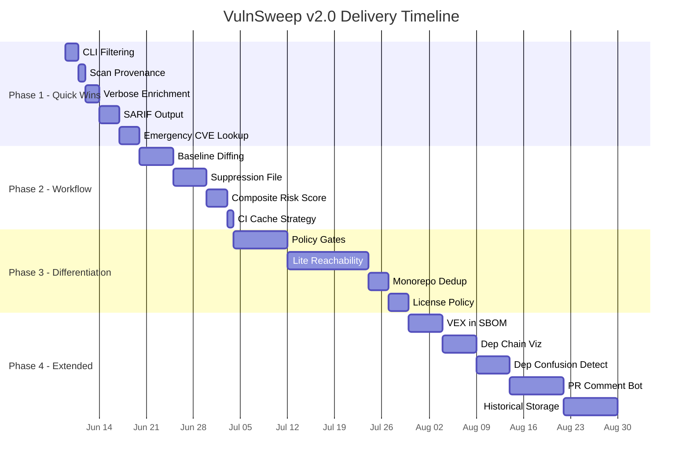
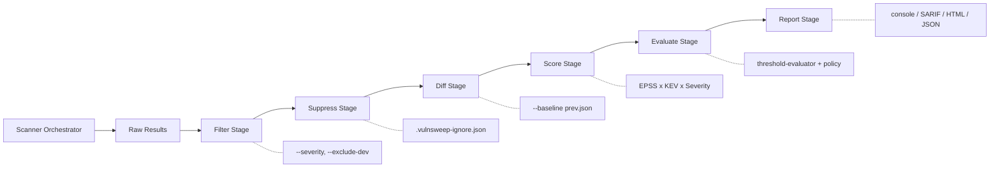
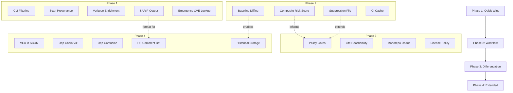

# VulnSweep v2.0 — Final Product Roadmap

> **Status:** Approved  
> **Version:** 2.0  
> **Created:** 2026-06-03  
> **Process:** Expert Panel → Code Pathologist Analysis → Architecture Plan  
> **Detailed Implementation:** [`plans/IMPLEMENTATION_PLAN.md`](IMPLEMENTATION_PLAN.md)

---

## How to Use This Document

This roadmap is the **starting point for all v2.0 development**. It synthesizes input from three domain experts into a prioritized, phased delivery plan.

- **For developers:** Start with Phase 1. Each feature is independent and can be implemented in isolation. Refer to [`plans/IMPLEMENTATION_PLAN.md`](IMPLEMENTATION_PLAN.md) for file-level technical specifications.
- **For product owners:** Use the Value/Complexity scores to make trade-off decisions if timelines shift.
- **For stakeholders:** The Timeline Summary (Section 4) gives the high-level view. Success Metrics (Section 6) define what "done" looks like per phase.

---

## Table of Contents

1. [Executive Summary](#1-executive-summary)
2. [Phased Roadmap](#2-phased-roadmap)
3. [Rejected Features](#3-rejected-features-and-why)
4. [Overall Timeline Summary](#4-overall-timeline-summary)
5. [Key Architecture Decisions](#5-key-architecture-decisions)
6. [Success Metrics Per Phase](#6-success-metrics-per-phase)
7. [Expert Consensus Points](#7-expert-consensus-points)

---

## 1. Executive Summary

Three security experts were consulted to identify the highest-impact features for VulnSweep v2.0:

| Expert | Domain | Key Contribution |
|--------|--------|------------------|
| **Security Engineer** | DevSecOps, CI/CD, compliance | SARIF output, policy gates, pipeline integration |
| **Cybersecurity Expert** | Threat detection, vulnerability assessment | Reachability analysis, dependency confusion, risk scoring |
| **AI Engineer** | Intelligent prioritization | EPSS/KEV enrichment, composite scoring, suppression logic |

**The Code Pathologist** moderated the discussion, filtered proposals through a Value/Complexity matrix, and rejected features that exceeded the product's market segment (individual devs and small teams at €10-30/year).

**The Architect** then transformed the approved features into a phased implementation plan with file-level specifications, test strategies, and architecture constraints.

The result: **18 features across 4 phases**, ordered strictly by value-to-complexity ratio, with zero architectural debt introduced.

---

## 2. Phased Roadmap

> **Ordering principle:** Low complexity + High value FIRST

---

### Phase 1: v2.0.0 — Quick Wins

**Release Theme:** *"See more, filter better, integrate everywhere"*

These are trivial to implement, immediately valuable, and require no architectural changes.

| # | Feature | Value | Complexity | Time | Key Change |
|---|---------|:-----:|:----------:|:----:|------------|
| 1 | CLI Filtering (`--severity critical,high`, `--exclude-dev`, `--group-by severity`) | 7/10 | 1/10 | 2 days | Filter array in runner.js before reporting |
| 2 | Scan Provenance (show sources that succeeded/failed/timed-out) | 6/10 | 1/10 | 1 day | Surface allSettled results from scanner-orchestrator |
| 3 | Verbose CLI Enrichment (`--verbose` showing EPSS, KEV, CVSS vector) | 6/10 | 1/10 | 2 days | Add columns to console-reporter |
| 4 | SARIF Output Format (`--sarif <path>`) | 8/10 | 2/10 | 3 days | New sarif-writer.js serializer |
| 5 | Emergency CVE Lookup (`vulnsweep check CVE-2024-XXXX`) | 8/10 | 2/10 | 3 days | New subcommand, reads lockfile, queries against specific CVE |

**Total:** ~15 dev-days | **5 features** | **Zero new dependencies**

---

### Phase 2: v2.1.0 — Workflow Transformation

**Release Theme:** *"Silence the noise, see only what matters"*

These transform the daily scanning workflow from noisy to actionable.

| # | Feature | Value | Complexity | Time | Key Change |
|---|---------|:-----:|:----------:|:----:|------------|
| 6 | Baseline Diffing (`--baseline prev.json`) | 9/10 | 3/10 | 5 days | Compare two result JSONs, output new/resolved/changed |
| 7 | Suppression/Ignore File (`.vulnsweep-ignore.json`) | 9/10 | 3/10 | 5 days | JSON file + CLI `vulnsweep ignore` + filter before threshold eval |
| 8 | Composite Risk Score | 6/10 | 2/10 | 3 days | Formula: severity x EPSS x KEV boost. Show in reports |
| 9 | CI Cache Strategy (`--cache-dir`) | 3/10 | 1/10 | 1 day | Point scan-cache at custom directory |

**Total:** ~20 dev-days | **4 features** | **Zero new dependencies**

---

### Phase 3: v2.2.0 — Competitive Differentiation

**Release Theme:** *"Enterprise-lite intelligence without enterprise pricing"*

These differentiate VulnSweep from basic scanners.

| # | Feature | Value | Complexity | Time | Key Change |
|---|---------|:-----:|:----------:|:----:|------------|
| 10 | Simple Policy Gates (`.vulnsweep-policy.yml`) | 7/10 | 3/10 | 8 days | YAML config extending threshold-evaluator with KEV/EPSS conditions |
| 11 | Lite Reachability Analysis | 8/10 | 4/10 | 12 days | AST grep for require/import of vulnerable packages + dev dep flag |
| 12 | Monorepo Deduplication | 4/10 | 2/10 | 3 days | Group results by CVE ID across workspace results |
| 13 | License Policy Enforcement | 4/10 | 2/10 | 3 days | YAML config for approved/banned licenses as CI gate |

**Total:** ~30 dev-days | **4 features** | **Minimal new dependencies (YAML parser only)**

---

### Phase 4: v2.3.0 — Extended Capabilities

**Release Theme:** *"Full security lifecycle coverage"*

Only if previous phases are stable and customer demand exists.

| # | Feature | Value | Complexity | Time | Key Change |
|---|---------|:-----:|:----------:|:----:|------------|
| 14 | VEX in SBOM | 5/10 | 3/10 | 5 days | CycloneDX VEX extension with vuln status |
| 15 | Dependency Chain Visualization | 5/10 | 3/10 | 5 days | Walk lock file tree, ASCII output |
| 16 | Dependency Confusion Detection | 5/10 | 3/10 | 5 days | Levenshtein + scope check against popular pkgs |
| 17 | PR Comment Bot (GitHub Action) | 6/10 | 4/10 | 8 days | GitHub API integration for PR comments |
| 18 | Historical Scan Storage | 5/10 | 4/10 | 8 days | JSONL append-only log + `vulnsweep history` command |

**Total:** ~35 dev-days | **5 features** | **GitHub API dependency for PR bot only**

---

## 3. Rejected Features (and Why)

Features proposed by experts but rejected by the Code Pathologist as unsuitable for VulnSweep's market segment (individual developers and small teams at €10-30/year):

| Feature | Proposed By | Reason for Rejection |
|---------|-------------|---------------------|
| SOC2/ISO 27001 Compliance Evidence | Security Engineer | Wrong market — €10-30/year users don't have auditors |
| SIEM Output (CEF/LEEF) | Security Engineer | Target users don't have Splunk/Sentinel |
| Pipeline Attestation (SLSA/in-toto) | Security Engineer | VulnSweep is a scanner, not a build system |
| Threat Actor Attribution | Cybersecurity Expert | No reliable mapping from npm packages to APT groups |
| Incident Playbook Generation | Cybersecurity Expert | Not a SOAR platform; playbook is always "update the package" |
| MITRE ATT&CK Mapping | Cybersecurity Expert | Academic exercise with no practical value here |
| Full Reachability Analysis | Cybersecurity Expert | Multi-year research project; lite version is Phase 3 instead |
| Attack Surface Enumeration | Cybersecurity Expert | Requires full semantic analysis, wrong tool category |
| Maintainer Risk Assessment | Cybersecurity Expert | No reliable free data source exists for npm maintainer trust |

**Key insight:** Every rejected feature either targets a different market segment (enterprise/SOC teams) or requires data/infrastructure that doesn't exist for the npm ecosystem at a price point users would accept.

---

## 4. Overall Timeline Summary

```
Week 1-3:   Phase 1 (v2.0.0) — Quick Wins         [5 features, ~15 days]
Week 4-7:   Phase 2 (v2.1.0) — Workflow Transform  [4 features, ~20 days]
Week 8-13:  Phase 3 (v2.2.0) — Differentiation     [4 features, ~30 days]
Week 14-20: Phase 4 (v2.3.0) — Extended            [5 features, ~35 days]
─────────────────────────────────────────────────────────────────────────
Total: ~20 weeks (5 months) for full roadmap, 1 developer
```



---

## 5. Key Architecture Decisions

| Decision | Rationale |
|----------|-----------|
| **Post-scan pipeline pattern** | All features operate as composable stages AFTER the scanner completes: filter → suppress → diff → score → evaluate → report |
| **Zero new dependencies in Phase 1-2** | Only Node.js built-ins. Reduces supply chain risk (eating our own dog food) |
| **Additive result extension** | New fields added to existing result objects, never breaking changes to the JSON schema |
| **Each phase = independent shippable release** | No phase depends on a later phase. Any phase can be the "last" phase shipped |
| **CLI-first, GUI-second** | All features implemented as CLI flags/subcommands first; Electron GUI wraps them later |
| **No database** | JSONL files and JSON configs only. No SQLite, no server, no state management complexity |

### Post-Scan Pipeline Architecture



---

## 6. Success Metrics Per Phase

| Phase | Success Criteria |
|-------|-----------------|
| **Phase 1** | Users can filter noise and integrate with GitHub Code Scanning via SARIF upload |
| **Phase 2** | Users only see NEW vulnerabilities, can suppress known-accepted risks, CI gates become usable in real projects |
| **Phase 3** | Organizations can encode security policies as code, developers know if vulnerable code is even reachable |
| **Phase 4** | Full security lifecycle from detection through history and compliance artifacts |

### Measurable KPIs

- **Phase 1:** SARIF upload to GitHub succeeds; `--severity critical` reduces output by >60% on typical projects
- **Phase 2:** Repeat scans with `--baseline` show zero false "new" vulns; suppressed CVEs don't trigger exit code 1
- **Phase 3:** Policy file blocks CI on KEV-listed vulns; reachability marks >30% of vulns as "not imported"
- **Phase 4:** `vulnsweep history` shows trend data; PR bot comments appear within 30s of scan completion

---

## 7. Expert Consensus Points

### Unanimous Agreement (3/3 experts) — Strongest implementation signal

| # | Feature | Phase |
|---|---------|-------|
| 1 | ✅ Baseline diffing / scan delta | Phase 2 |
| 2 | ✅ Policy-as-code beyond simple threshold | Phase 3 |
| 3 | ✅ VEX support | Phase 4 |
| 4 | ✅ Scan persistence / history | Phase 4 |

### Strong Agreement (2/3 experts)

| # | Feature | Phase | Note |
|---|---------|-------|------|
| 1 | ✅ SARIF output | Phase 1 | Universal CI integration format |
| 2 | ✅ Reachability analysis | Phase 3 | Lite version only; full version rejected |
| 3 | ✅ Webhook notifications | Deferred | Exit codes are sufficient for target users |
| 4 | ✅ Dependency confusion detection | Phase 4 | Growing threat vector in npm ecosystem |

### Divergent Opinions (resolved by Code Pathologist)

| Topic | Security Engineer | Cybersecurity Expert | Resolution |
|-------|-------------------|---------------------|------------|
| Compliance artifacts | Full SOC2 evidence | MITRE mapping | Both rejected — wrong market |
| Reachability depth | Not mentioned | Full call-graph analysis | Lite AST grep compromise |
| Notification method | Webhooks to Slack | SIEM integration | Deferred entirely — exit codes suffice |
| Risk scoring | CVSS only | Custom threat model | Composite score: CVSS x EPSS x KEV |

---

## Appendix: Feature Dependency Graph



> **Note:** Dotted lines show logical relationships, not hard dependencies. Each feature can be implemented independently within its phase.

---

*For detailed file-level implementation specifications, test strategies, and code examples, see [`plans/IMPLEMENTATION_PLAN.md`](IMPLEMENTATION_PLAN.md).*
