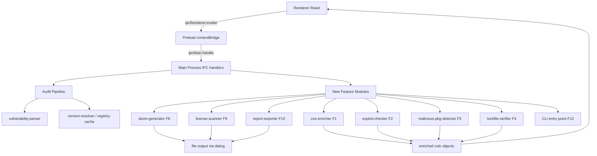

# VulnSweep — 8-Feature Implementation Plan

## Progress Tracker

| Feature                              | Status     | Completed  |
| ------------------------------------ | ---------- | ---------- |
| F1 — Cross-Source CVE Correlation    | ✅ Done    | 2026-05-11 |
| F2 — Exploit Availability Flag       | ⬜ Pending | —          |
| F3 — Malicious Package Detection     | ⬜ Pending | —          |
| F4 — Lockfile Integrity Verification | ⬜ Pending | —          |
| F8 — SBOM Generation                 | ⬜ Pending | —          |
| F9 — License Compliance Scanning     | ⬜ Pending | —          |
| F10 — Exportable Security Reports    | ⬜ Pending | —          |
| F12 — CI/CD Headless CLI             | ⬜ Pending | —          |

---

## Codebase Reference Summary

- **Main process entry**: [`src/main/main.js`](src/main/main.js)
- **Audit pipeline**: [`src/main/modules/audit/index.js`](src/main/modules/audit/index.js) — 5-step: install → audit → parse → strategize → fix
- **Vulnerability parser**: [`src/main/modules/audit/parsers/vulnerability-parser.js`](src/main/modules/audit/parsers/vulnerability-parser.js)
- **Version resolver**: [`src/main/modules/audit/strategies/version-resolver.js`](src/main/modules/audit/strategies/version-resolver.js)
- **Registry cache**: [`src/main/utils/registry-cache.js`](src/main/utils/registry-cache.js) — `RegistryCache` class, 5-min TTL
- **Result monad**: [`src/main/utils/result.js`](src/main/utils/result.js) — `createSuccess` / `createError`
- **Preload bridge**: [`src/preload/preload.js`](src/preload/preload.js) — `contextBridge.exposeInMainWorld('electronAPI', ...)`
- **Root React component**: [`src/renderer/App.jsx`](src/renderer/App.jsx) — tab state: `scanner` / `statistics`
- **Vulnerability grid**: [`src/renderer/components/VulnerabilityGrid.jsx`](src/renderer/components/VulnerabilityGrid.jsx)
- **Statistics tab**: [`src/renderer/components/StatisticsTab.jsx`](src/renderer/components/StatisticsTab.jsx) — already has basic PDF export via `jspdf`
- **Constants**: [`src/main/config/constants.js`](src/main/config/constants.js)
- **Existing deps**: `jspdf`, `jspdf-autotable`, `recharts`, `semver`, `react@18`, Tailwind CSS, Electron 41, Node 18 LTS

---

## Architecture Data-Flow Diagram

---

## F1 — Cross-Source CVE Correlation ✅ COMPLETED

### Implementation Summary

**Status**: ✅ COMPLETED — 2026-05-11

**Files Created:**

- [`src/main/modules/enrichment/sources/osv-source.js`](src/main/modules/enrichment/sources/osv-source.js) — OSV.dev API client (`queryOSV(packageName, version)`)
- [`src/main/modules/enrichment/sources/nvd-source.js`](src/main/modules/enrichment/sources/nvd-source.js) — NVD API v2 client (`queryNVD(cveId)`) with 6s rate-limit queue for free tier
- [`src/main/modules/enrichment/sources/github-advisory-source.js`](src/main/modules/enrichment/sources/github-advisory-source.js) — GitHub Advisory REST client (`queryGitHubAdvisory(id)`)
- [`src/main/modules/enrichment/severity-merger.js`](src/main/modules/enrichment/severity-merger.js) — Severity merge + discrepancy detection across all sources
- [`src/main/modules/enrichment/cve-enricher.js`](src/main/modules/enrichment/cve-enricher.js) — Enrichment orchestrator with 30-min in-process cache
- [`__tests__/fixtures/osv-response.json`](__tests__/fixtures/osv-response.json) — OSV API fixture
- [`__tests__/fixtures/nvd-response.json`](__tests__/fixtures/nvd-response.json) — NVD API v2 fixture
- [`__tests__/fixtures/github-advisory-response.json`](__tests__/fixtures/github-advisory-response.json) — GitHub Advisory fixture
- [`__tests__/main/modules/enrichment/cve-enricher.test.js`](__tests__/main/modules/enrichment/cve-enricher.test.js) — 29 unit tests (all passing)

**Files Modified:**

- [`src/main/config/constants.js`](src/main/config/constants.js) — Added `ENRICHMENT_CONFIG`
- [`src/main/main.js`](src/main/main.js) — Added `enrich-vulnerabilities` and `get-enrichment-settings` IPC handlers
- [`src/preload/preload.js`](src/preload/preload.js) — Exposed `enrichVulnerabilities`, `getEnrichmentSettings`, `onEnrichmentProgress` via `contextBridge`
- [`src/renderer/App.jsx`](src/renderer/App.jsx) — Added `isEnriching` + `enrichmentProgress` state; auto-triggers enrichment after scan
- [`src/renderer/components/VulnerabilityGrid.jsx`](src/renderer/components/VulnerabilityGrid.jsx) — Added NVD CVSS column + Sources badges column + enrichment progress banner

**Test results**: 29/29 unit tests passing

---

### Goal

After `npm audit` runs, enrich each vulnerability by querying OSV.dev, NVD API v2, and optionally the GitHub Advisory GraphQL API. Merge results into
