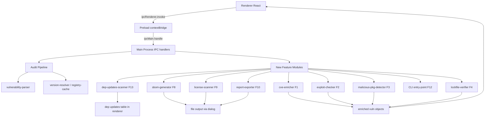

# VulnSweep — 9-Feature Implementation Plan

## Progress Tracker

| Feature                              | Status     | Completed  |
| ------------------------------------ | ---------- | ---------- |
| F1 — Cross-Source CVE Correlation    | ✅ Done    | 2026-05-11 |
| F2 — Exploit Availability Flag       | ⬜ Pending | —          |
| F3 — Malicious Package Detection     | ⬜ Pending | —          |
| F4 — Lockfile Integrity Verification | ⬜ Pending | —          |
| F8 — SBOM Generation                 | ⬜ Pending | —          |
| F9 — License Compliance Scanning     | ⬜ Pending | —          |
| F10 — Exportable Security Reports    | ⬜ Pending | —          |
| F12 — CI/CD Headless CLI             | ⬜ Pending | —          |
| F13 — Dependency Updates             | ⬜ Pending | —          |

---

## Codebase Reference Summary

- **Main process entry**: [`src/main/main.js`](src/main/main.js)
- **Audit pipeline**: [`src/main/modules/audit/index.js`](src/main/modules/audit/index.js) — 5-step: install → audit → parse → strategize → fix
- **Vulnerability parser**: [`src/main/modules/audit/parsers/vulnerability-parser.js`](src/main/modules/audit/parsers/vulnerability-parser.js)
- **Version resolver**: [`src/main/modules/audit/strategies/version-resolver.js`](src/main/modules/audit/strategies/version-resolver.js)
- **Registry cache**: [`src/main/utils/registry-cache.js`](src/main/utils/registry-cache.js) — `RegistryCache` class, 5-min TTL
- **Result monad**: [`src/main/utils/result.js`](src/main/utils/result.js) — `createSuccess` / `createError`
- **Preload bridge**: [`src/preload/preload.js`](src/preload/preload.js) — `contextBridge.exposeInMainWorld('electronAPI', ...)`
- **Root React component**: [`src/renderer/App.jsx`](src/renderer/App.jsx) — tab state: `scanner` / `statistics`
- **Vulnerability grid**: [`src/renderer/components/VulnerabilityGrid.jsx`](src/renderer/components/VulnerabilityGrid.jsx)
- **Statistics tab**: [`src/renderer/components/StatisticsTab.jsx`](src/renderer/components/StatisticsTab.jsx) — already has basic PDF export via `jspdf`
- **Constants**: [`src/main/config/constants.js`](src/main/config/constants.js)
- **Existing deps**: `jspdf`, `jspdf-autotable`, `recharts`, `semver`, `react@18`, Tailwind CSS, Electron 41, Node 18 LTS

---

## Architecture Data-Flow Diagram

---

## F1 — Cross-Source CVE Correlation ✅ COMPLETED

### Implementation Summary

**Status**: ✅ COMPLETED — 2026-05-11

**Files Created:**

- [`src/main/modules/enrichment/sources/osv-source.js`](src/main/modules/enrichment/sources/osv-source.js) — OSV.dev API client (`queryOSV(packageName, version)`)
- [`src/main/modules/enrichment/sources/nvd-source.js`](src/main/modules/enrichment/sources/nvd-source.js) — NVD API v2 client (`queryNVD(cveId)`) with 6s rate-limit queue for free tier
- [`src/main/modules/enrichment/sources/github-advisory-source.js`](src/main/modules/enrichment/sources/github-advisory-source.js) — GitHub Advisory REST client (`queryGitHubAdvisory(id)`)
- [`src/main/modules/enrichment/severity-merger.js`](src/main/modules/enrichment/severity-merger.js) — Severity merge + discrepancy detection across all sources
- [`src/main/modules/enrichment/cve-enricher.js`](src/main/modules/enrichment/cve-enricher.js) — Enrichment orchestrator with 30-min in-process cache
- [`__tests__/fixtures/osv-response.json`](__tests__/fixtures/osv-response.json) — OSV API fixture
- [`__tests__/fixtures/nvd-response.json`](__tests__/fixtures/nvd-response.json) — NVD API v2 fixture
- [`__tests__/fixtures/github-advisory-response.json`](__tests__/fixtures/github-advisory-response.json) — GitHub Advisory fixture
- [`__tests__/main/modules/enrichment/cve-enricher.test.js`](__tests__/main/modules/enrichment/cve-enricher.test.js) — 29 unit tests (all passing)

**Files Modified:**

- [`src/main/config/constants.js`](src/main/config/constants.js) — Added `ENRICHMENT_CONFIG`
- [`src/main/main.js`](src/main/main.js) — Added `enrich-vulnerabilities` and `get-enrichment-settings` IPC handlers
- [`src/preload/preload.js`](src/preload/preload.js) — Exposed `enrichVulnerabilities`, `getEnrichmentSettings`, `onEnrichmentProgress` via `contextBridge`
- [`src/renderer/App.jsx`](src/renderer/App.jsx) — Added `isEnriching` + `enrichmentProgress` state; auto-triggers enrichment after scan
- [`src/renderer/components/VulnerabilityGrid.jsx`](src/renderer/components/VulnerabilityGrid.jsx) — Added NVD CVSS column + Sources badges column + enrichment progress banner

**Test results**: 29/29 unit tests passing

---

### Goal

After `npm audit` runs, enrich each vulnerability by querying OSV.dev, NVD API v2, and optionally the GitHub Advisory GraphQL API. Merge results into a unified severity score with CVE-GHSA alias mapping. Surface discrepancies.

---

## F13 — Dependency Updates

### Goal

Provide a dedicated **Dependency Updates** tab in the UI that scans the project's **direct dependencies only** (not transitive) and shows what newer versions are available. Users select a target version per package and apply updates in one action; resulting commits mention the libraries updated and their new versions. This feature is **free** — no license or paywall check required.

---

### New Files

| Path                                                             | Purpose                                                                                                                                                                                      |
| ---------------------------------------------------------------- | -------------------------------------------------------------------------------------------------------------------------------------------------------------------------------------------- |
| `src/main/modules/dep-updates/dep-updates-scanner.js`            | Reads direct deps from `package.json`, fetches all published versions from the npm registry per package, filters out versions not greater than current, returns structured update candidates |
| `src/main/modules/dep-updates/version-comparator.js`             | Semver + non-standard pre-release comparison helpers: same-major detection, version pre-selection logic, risk level computation                                                              |
| `src/renderer/components/DependencyUpdatesTab.jsx`               | Dedicated React tab: dependency table with Library / Current Version / Suggested Version dropdown / Risk Level columns; Apply Fixes button                                                   |
| `__tests__/main/modules/dep-updates/dep-updates-scanner.test.js` | Unit tests: direct-dep extraction, registry fetch mocking, pre-release version filtering                                                                                                     |
| `__tests__/main/modules/dep-updates/version-comparator.test.js`  | Unit tests: same-major pre-selection, cross-major fallback, risk level derivation, non-standard version strings                                                                              |
| `__tests__/renderer/components/DependencyUpdatesTab.test.jsx`    | Component tests: table rendering, dropdown interaction, risk badge dynamic re-render, Up-to-date label path                                                                                  |

---

### Existing Files to Modify

| File                                                                       | Change                                                                                                    |
| -------------------------------------------------------------------------- | --------------------------------------------------------------------------------------------------------- |
| [`src/main/main.js`](src/main/main.js)                                     | Add `ipcMain.handle('scan-dep-updates', ...)` and `ipcMain.handle('apply-dep-updates', ...)` IPC handlers |
| [`src/preload/preload.js`](src/preload/preload.js)                         | Expose `scanDepUpdates`, `applyDepUpdates`, `onDepUpdateProgress` via `contextBridge`                     |
| [`src/renderer/App.jsx`](src/renderer/App.jsx)                             | Add `dep-updates` to tab state; render `DependencyUpdatesTab` when active                                 |
| [`src/renderer/components/Header.jsx`](src/renderer/components/Header.jsx) | Add Dependency Updates tab navigation entry                                                               |
| [`src/main/config/constants.js`](src/main/config/constants.js)             | Add `DEP_UPDATES_CONFIG` with `NPM_REGISTRY_URL` and `REGISTRY_TIMEOUT_MS`                                |

---

### New npm Dependencies

None — `semver` is already a listed dependency; native `fetch` from Node 18 LTS handles all registry calls.

---

### New IPC Channels

| Channel               | Direction             | Payload Schema                                            |
| --------------------- | --------------------- | --------------------------------------------------------- |
| `scan-dep-updates`    | Renderer to Main      | `{ projectPath: string }`                                 |
| `apply-dep-updates`   | Renderer to Main      | `{ updates: Array of { name, fromVersion, toVersion } }`  |
| `dep-update-progress` | Main to Renderer push | `{ current: number, total: number, packageName: string }` |

---

### UI — Dependency Table Specification

The [`src/renderer/components/DependencyUpdatesTab.jsx`](src/renderer/components/DependencyUpdatesTab.jsx) component renders a table with the following columns:

| Column                | Description                                                                                                                                                                                                                                                                                        |
| --------------------- | -------------------------------------------------------------------------------------------------------------------------------------------------------------------------------------------------------------------------------------------------------------------------------------------------- |
| **Library**           | Package name from `dependencies` or `devDependencies` in `package.json`                                                                                                                                                                                                                            |
| **Current Version**   | Installed version string resolved from `node_modules` or `package-lock.json`                                                                                                                                                                                                                       |
| **Suggested Version** | Dropdown listing all versions strictly greater than current, including pre-release (alpha, beta, rc). Pre-selection: newest same-major if any exists; otherwise latest overall. If no newer version exists, show a green Up-to-date label instead of a dropdown. User can change selection freely. |
| **Risk Level**        | Badge auto-computed from selected version: **Low** if same major as current; **High** if different major. Updates dynamically when the user changes the dropdown selection.                                                                                                                        |

The Apply Fixes button triggers the `applyDepUpdates` IPC call with current selections. Progress is streamed via `dep-update-progress`. Each resulting git commit uses the message pattern: `chore: update pkg1@v1, pkg2@v2`.

---

### Ordered Task List

1. Add `DEP_UPDATES_CONFIG` to [`src/main/config/constants.js`](src/main/config/constants.js) with `NPM_REGISTRY_URL` (`https://registry.npmjs.org`) and `REGISTRY_TIMEOUT_MS`
2. Create `src/main/modules/dep-updates/version-comparator.js`: `isSameMajor(vA, vB)` using `semver.coerce`; `compareVersions(vA, vB)` semver-aware with string fallback; `preSelectVersion(currentVersion, availableVersions)` returning newest same-major first, then newest overall, or `null` if no newer version; `computeRiskLevel(currentVersion, selectedVersion)` returning `'Low'` or `'High'`
3. Create `src/main/modules/dep-updates/dep-updates-scanner.js`: `readDirectDependencies(projectPath)` reads `package.json` deps and resolves installed version from `node_modules`; `fetchAllVersions(packageName)` uses `RegistryCache`-backed GET to npm registry; `buildUpdateCandidates(projectPath)` returns `Array of { name, currentVersion, availableVersions, recommendedVersion, riskLevel }`
4. Register `ipcMain.handle('scan-dep-updates', ...)` in [`src/main/main.js`](src/main/main.js) calling `buildUpdateCandidates` and returning the result array
5. Register `ipcMain.handle('apply-dep-updates', ...)` in [`src/main/main.js`](src/main/main.js): runs `npm install pkg@version` per selected update, streams progress via `dep-update-progress`, then calls [`src/main/modules/git.js`](src/main/modules/git.js) to commit with message `chore: update pkg1@v1, pkg2@v2`
6. Expose `scanDepUpdates`, `applyDepUpdates`, `onDepUpdateProgress` in [`src/preload/preload.js`](src/preload/preload.js) via `contextBridge`
7. Create [`src/renderer/components/DependencyUpdatesTab.jsx`](src/renderer/components/DependencyUpdatesTab.jsx): fetch candidates on mount via `scanDepUpdates`; render table with Library, Current Version, Suggested Version dropdown or Up-to-date label, Risk Level badge; Apply Fixes button calls `applyDepUpdates` with current selections; risk badge re-computes on each dropdown change
8. Add `dep-updates` tab state to [`src/renderer/App.jsx`](src/renderer/App.jsx) and render `DependencyUpdatesTab` when active
9. Add Dependency Updates tab button to [`src/renderer/components/Header.jsx`](src/renderer/components/Header.jsx)
10. Write unit tests for `version-comparator.js`: same-major pre-selection, cross-major fallback, risk level derivation, non-standard pre-release strings (alpha, beta, rc)
11. Write unit tests for `dep-updates-scanner.js`: direct-dep extraction, `fetchAllVersions` with mocked registry response, `buildUpdateCandidates` end-to-end with mock data
12. Write component tests for `DependencyUpdatesTab.jsx`: table renders correctly, dropdown changes update Risk Level badge, Up-to-date label renders when no updates, Apply Fixes calls IPC with correct payload

---

### Testing Approach

- Mock `fetch` globally in Jest for registry calls; provide fixture JSON with a set of known versions
- Test `version-comparator.js` with semver versions, pre-release strings (1.0.0-alpha.1, 2.0.0-rc.3), and non-parseable strings
- Test `dep-updates-scanner.js` with a mock `package.json` containing 3 direct deps; assert correct `availableVersions` filtering and `recommendedVersion` selection
- Test `DependencyUpdatesTab.jsx` with React Testing Library: assert dropdown options, simulate selection change, assert Risk Level badge text changes, assert Apply Fixes button passes correct payload
- No paywall or license guard tests required — feature is free
