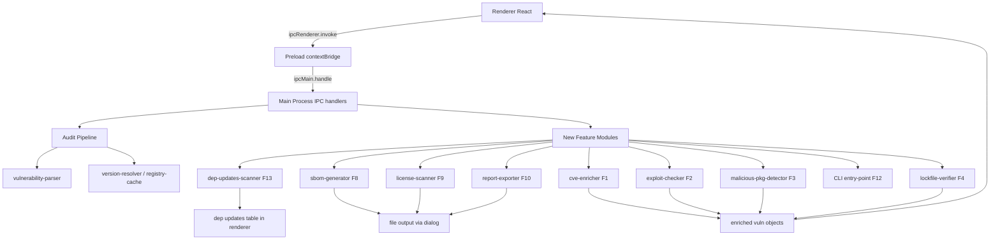

# VulnSweep — 9-Feature Implementation Plan

## Progress Tracker

| Feature                              | Status     | Completed  |
| ------------------------------------ | ---------- | ---------- |
| F1 — Cross-Source CVE Correlation    | ✅ Done    | 2026-05-11 |
| F2 — Exploit Availability Flag       | ✅ Done    | 2026-05-12 |
| F3 — Malicious Package Detection     | ⬜ Pending | —          |
| F4 — Lockfile Integrity Verification | ⬜ Pending | —          |
| F8 — SBOM Generation                 | ✅ Done    | 2026-05-13 |
| F9 — License Compliance Scanning     | ✅ Done    | 2026-05-13 |
| F10 — Exportable Security Reports    | ⬜ Pending | —          |
| F12 — CI/CD Headless CLI             | ⬜ Pending | —          |
| F13 — Dependency Updates             | ✅ Done    | 2026-05-13 |

---

## Codebase Reference Summary

- **Main process entry**: [`src/main/main.js`](src/main/main.js)
- **Audit pipeline**: [`src/main/modules/audit/index.js`](src/main/modules/audit/index.js) — 5-step: install → audit → parse → strategize → fix
- **Vulnerability parser**: [`src/main/modules/audit/parsers/vulnerability-parser.js`](src/main/modules/audit/parsers/vulnerability-parser.js)
- **Version resolver**: [`src/main/modules/audit/strategies/version-resolver.js`](src/main/modules/audit/strategies/version-resolver.js)
- **Registry cache**: [`src/main/utils/registry-cache.js`](src/main/utils/registry-cache.js) — `RegistryCache` class, 5-min TTL
- **Result monad**: [`src/main/utils/result.js`](src/main/utils/result.js) — `createSuccess` / `createError`
- **Preload bridge**: [`src/preload/preload.js`](src/preload/preload.js) — `contextBridge.exposeInMainWorld('electronAPI', ...)`
- **Root React component**: [`src/renderer/App.jsx`](src/renderer/App.jsx) — tab state: `scanner` / `statistics`
- **Vulnerability grid**: [`src/renderer/components/VulnerabilityGrid.jsx`](src/renderer/components/VulnerabilityGrid.jsx)
- **Statistics tab**: [`src/renderer/components/StatisticsTab.jsx`](src/renderer/components/StatisticsTab.jsx) — already has basic PDF export via `jspdf`
- **Constants**: [`src/main/config/constants.js`](src/main/config/constants.js)
- **Existing deps**: `jspdf`, `jspdf-autotable`, `recharts`, `semver`, `react@18`, Tailwind CSS, Electron 41, Node 18 LTS

---

## Architecture Data-Flow Diagram

---

## F1 — Cross-Source CVE Correlation ✅ COMPLETED

### Implementation Summary

**Status**: ✅ COMPLETED — 2026-05-11

**Files Created:**

- [`src/main/modules/enrichment/sources/osv-source.js`](src/main/modules/enrichment/sources/osv-source.js) — OSV.dev API client (`queryOSV(packageName, version)`)
- [`src/main/modules/enrichment/sources/nvd-source.js`](src/main/modules/enrichment/sources/nvd-source.js) — NVD API v2 client (`queryNVD(cveId)`) with 6s rate-limit queue for free tier
- [`src/main/modules/enrichment/sources/github-advisory-source.js`](src/main/modules/enrichment/sources/github-advisory-source.js) — GitHub Advisory REST client (`queryGitHubAdvisory(id)`)
- [`src/main/modules/enrichment/severity-merger.js`](src/main/modules/enrichment/severity-merger.js) — Severity merge + discrepancy detection across all sources
- [`src/main/modules/enrichment/cve-enricher.js`](src/main/modules/enrichment/cve-enricher.js) — Enrichment orchestrator with 30-min in-process cache
- [`__tests__/fixtures/osv-response.json`](__tests__/fixtures/osv-response.json) — OSV API fixture
- [`__tests__/fixtures/nvd-response.json`](__tests__/fixtures/nvd-response.json) — NVD API v2 fixture
- [`__tests__/fixtures/github-advisory-response.json`](__tests__/fixtures/github-advisory-response.json) — GitHub Advisory fixture
- [`__tests__/main/modules/enrichment/cve-enricher.test.js`](__tests__/main/modules/enrichment/cve-enricher.test.js) — 29 unit tests (all passing)

**Files Modified:**

- [`src/main/config/constants.js`](src/main/config/constants.js) — Added `ENRICHMENT_CONFIG`
- [`src/main/main.js`](src/main/main.js) — Added `enrich-vulnerabilities` and `get-enrichment-settings` IPC handlers
- [`src/preload/preload.js`](src/preload/preload.js) — Exposed `enrichVulnerabilities`, `getEnrichmentSettings`, `onEnrichmentProgress` via `contextBridge`
- [`src/renderer/App.jsx`](src/renderer/App.jsx) — Added `isEnriching` + `enrichmentProgress` state; auto-triggers enrichment after scan
- [`src/renderer/components/VulnerabilityGrid.jsx`](src/renderer/components/VulnerabilityGrid.jsx) — Added NVD CVSS column + Sources badges column + enrichment progress banner

**Test results**: 29/29 unit tests passing

---

### Goal

After `npm audit` runs, enrich each vulnerability by querying OSV.dev, NVD API v2, and optionally the GitHub Advisory GraphQL API. Merge results into a unified severity score with CVE-GHSA alias mapping. Surface discrepancies.

---

## F8 — SBOM Generation ✅ COMPLETED

### Implementation Summary

**Status**: ✅ COMPLETED — 2026-05-13

**Files Created:**

- [`src/main/modules/sbom-generator.js`](src/main/modules/sbom-generator.js) — Pure serializer generating CycloneDX JSON v1.6, SPDX JSON v2.3, and RFC-4180 CSV

**Files Modified:**

- [`src/main/main.js`](src/main/main.js) — Added `sbom:get-save-path` and `sbom:export` IPC handlers with path traversal guard
- [`src/preload/preload.js`](src/preload/preload.js) — Exposed `sbomGetSavePath` and `sbomExport` bridge methods

**Key implementation details:**

- Export SBOM button on Licenses tab: user selects format (CycloneDX / SPDX / CSV), OS save dialog opens, file is written
- CycloneDX tool version reads live from `app.getVersion()` (currently `1.0.4`)
- SPDX `dataLicense: "CC0-1.0"` mandatory per spec; `documentNamespace` uses deepest common ancestor of all scanned project paths
- Free feature — no paywall

---

### Goal

Generate a Software Bill of Materials from the scanned project's dependency graph in industry-standard formats (CycloneDX JSON v1.6, SPDX JSON v2.3, CSV) and allow the user to save the file via a native OS save dialog.

---

## F9 — License Compliance Scanning ✅ COMPLETED

### Implementation Summary

**Status**: ✅ COMPLETED — 2026-05-13

**Files Created:**

- [`src/main/modules/license-scanner.js`](src/main/modules/license-scanner.js) — Parses `package-lock.json` v2/v3 `packages` field; 30-entry SPDX normalizer; compound SPDX expression handler mapping `(MIT OR Apache-2.0)` to `safe`; Safe/Warning/Dangerous/Unknown tier classification; PURL-spec-compliant scoped package encoding `%40scope/name`; `npmUrl` field on every entry
- [`src/renderer/components/LicensesTab.jsx`](src/renderer/components/LicensesTab.jsx) — Dedicated Licenses tab with CSS Grid layout: 4 counter cards in left 1fr column + donut chart spanning all 4 rows in right 2fr column; counter cards for Total Licenses / Total Warnings / Potential Problems / Need Review; per-SPDX-identifier donut chart with tier-colored shade palettes; At-Risk Libraries table for warning and dangerous tiers with npm link icons; Licenses Needing Review table for unknown tier hidden when empty; Export SBOM button with format selector and success/error feedback
- [`src/renderer/constants.js`](src/renderer/constants.js) — Added `LICENSE_TIER_COLORS`, `SBOM_FORMAT_LABELS`, `SBOM_FORMAT_EXT`

**Files Modified:**

- [`src/renderer/App.jsx`](src/renderer/App.jsx) — License scan auto-triggers after every completed audit scan via `useEffect`; scans all discovered project paths in parallel via `Promise.all`; merges multi-repo results; `licenseResult` stored in state with `projectPaths` array for SBOM metadata

**Key implementation details:**

- Free feature — no paywall

---

### Goal

After a scan completes, automatically parse `package-lock.json` to extract all transitive dependency licenses, classify them by risk tier, and surface at-risk and unrecognised licenses in a dedicated Licenses tab with a donut chart summary and actionable tables.

---

## F13 — Dependency Updates ✅ COMPLETED

### Implementation Summary

**Status**: ✅ COMPLETED — 2026-05-13

**Files Created:**

- [`src/main/modules/dep-updates/version-comparator.js`](src/main/modules/dep-updates/version-comparator.js) — Pure semver utility functions: `filterNewerVersions()`, `selectRecommendedVersion()`, `computeRiskLevel()`
- [`src/main/modules/dep-updates/dep-updates-scanner.js`](src/main/modules/dep-updates/dep-updates-scanner.js) — Async scanner: `scanDependencyUpdates()`, `applyUpdates()`. Uses Node.js built-in `https` + existing `RegistryCache`, sequential registry fetches, `execFile` for npm installs + git commit
- [`src/renderer/components/DependencyUpdatesTab.jsx`](src/renderer/components/DependencyUpdatesTab.jsx) — React component with scan/apply flow, progress tracking, results table with version dropdowns and risk badges
- [`__tests__/main/modules/dep-updates/version-comparator.test.js`](__tests__/main/modules/dep-updates/version-comparator.test.js) — 29 passing tests
- [`__tests__/main/modules/dep-updates/dep-updates-scanner.test.js`](__tests__/main/modules/dep-updates/dep-updates-scanner.test.js) — 22 passing tests
- [`__tests__/renderer/components/DependencyUpdatesTab.test.jsx`](__tests__/renderer/components/DependencyUpdatesTab.test.jsx) — 29 passing tests

**Files Modified:**

- [`src/main/config/constants.js`](src/main/config/constants.js) — Added `DEP_UPDATES_CONFIG` with `REGISTRY_URL`, `MAX_VERSIONS_SHOWN: 50`, `FETCH_TIMEOUT_MS: 10000`
- [`src/main/main.js`](src/main/main.js) — Added `scan-dep-updates` and `apply-dep-updates` IPC handlers
- [`src/preload/preload.js`](src/preload/preload.js) — Exposed `scanDepUpdates`, `applyDepUpdates`, `onDepUpdateProgress` via `contextBridge`
- [`src/renderer/App.jsx`](src/renderer/App.jsx) — Added `dep-updates` tab + `DependencyUpdatesTab` render block

**Code Review:** APPROVED WITH NOTES (Code Pathologist). Fixed: 10 ESLint warnings (import order + string concatenation). Fixed: 6 stale test assertions in `App.test.jsx`. Non-blocking notes: `--save` flag redundant in modern npm; individual update object fields not validated in `applyUpdates()`.

**Test results**: 80/80 tests passing across all 3 new test files

---

### Goal

Provide a dedicated **Dependency Updates** tab in the UI that scans the project's **direct dependencies only** (not transitive) and shows what newer versions are available. Users select a target version per package and apply updates in one action; resulting commits mention the libraries updated and their new versions. This feature is **free** — no license or paywall check required.
